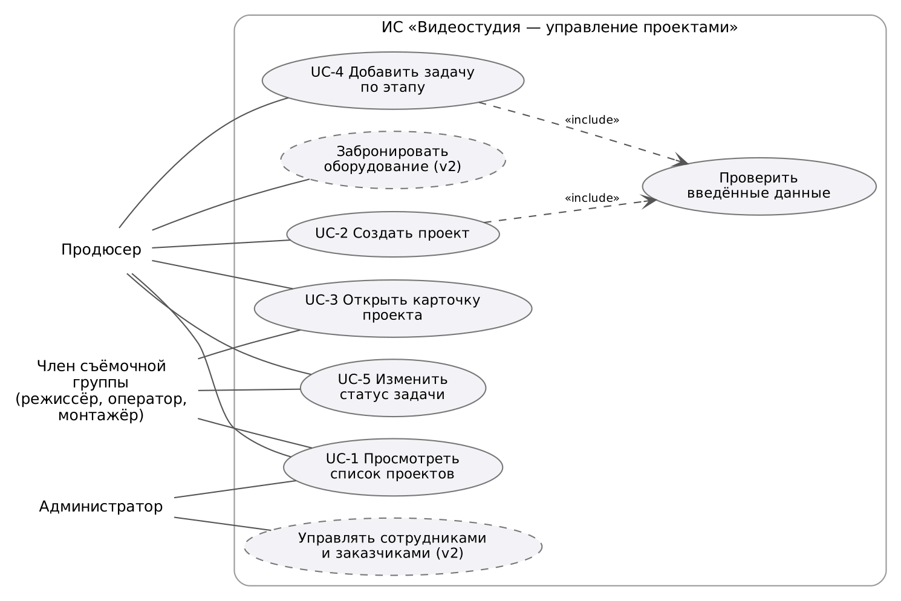
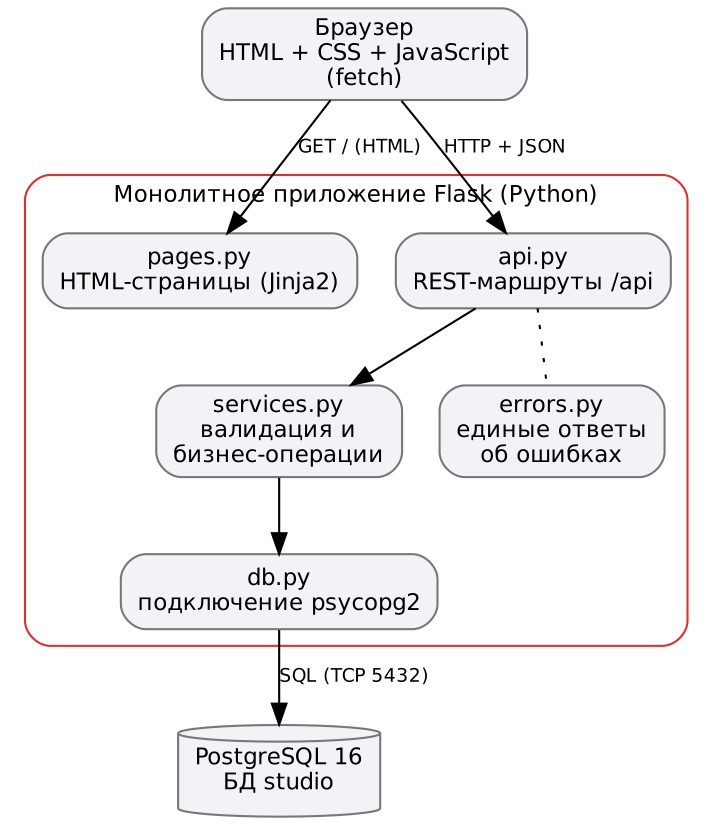

# Цель работы

Превратить идею из ПР №1 в проверяемые функциональные и нефункциональные требования, описать сценарии использования, выбрать стек технологий и составить план разработки с учётом рисков.

# 1. Краткое напоминание о проекте и ролях

ИС «Видеостудия/продакшн — управление проектами» — монолитное веб-приложение для учёта проектов видеостудии: заказчики, проекты, этапы производства, задачи, съёмочная группа и оборудование.

| Роль | Что делает в системе |
|---|---|
| Продюсер | Создаёт проекты, ведёт их по этапам, ставит задачи, контролирует сроки |
| Член съёмочной группы | Смотрит проекты и задачи, меняет статус своих задач |
| Администратор | Ведёт справочники и учётные записи (вторая версия) |

# 2. Функциональные требования

Приоритеты по методу MoSCoW: **M** — обязательно (Must), **S** — желательно (Should), **C** — можно (Could). Версия: 1 — MVP, 2 — следующие этапы курса.

| ID | Требование | Критерий проверки | Приоритет | Версия |
|---|---|---|---|---|
| FR-01 | Система показывает список проектов: название, тип, заказчик, продюсер, статус, дедлайн, прогресс задач | На странице «Проекты» видны все проекты из БД, прогресс = выполнено / всего задач | M | 1 |
| FR-02 | Фильтрация списка проектов по статусу | При выборе статуса показываются только проекты с этим статусом; неизвестный статус → ошибка 400 | S | 1 |
| FR-03 | Создание проекта с проверкой данных | Проект появляется в БД со статусом «Новый»; при пустом названии, несуществующем заказчике, отрицательном бюджете или дедлайне раньше начала — ошибка с указанием поля | M | 1 |
| FR-04 | Карточка проекта: данные, съёмочная группа, задачи | По адресу `/projects/{id}` выводятся все поля; несуществующий проект → «Проект не найден» | M | 1 |
| FR-05 | Добавление задачи проекта с этапом, исполнителем и сроком | Задача появляется в колонке своего этапа; пустое название или неверный этап → ошибка | M | 1 |
| FR-06 | Смена статуса задачи | Статус сохраняется в БД, прогресс проекта пересчитывается | M | 1 |
| FR-07 | Справочники заказчиков, сотрудников, оборудования (просмотр) | Списки доступны через API и используются в формах | S | 1 |
| FR-08 | Перевод проекта по этапам производства с правилами | Нельзя перевести в «Сдан», пока есть незакрытые задачи | S | 2 |
| FR-09 | Бронирование оборудования без пересечений | Попытка занять одну единицу на пересекающееся время отклоняется | C | 2 |
| FR-10 | Управление составом съёмочной группы проекта | Добавление/удаление участника с ролью в проекте | C | 2 |
| FR-11 | Вход в систему и права по ролям | Без входа данные недоступны; монтажёр не может создавать проекты | S | 2 |
| FR-12 | Отчёт о загрузке сотрудников | Число открытых задач по каждому сотруднику | C | 2 |

# 3. Нефункциональные требования

| ID | Требование | Измеримый критерий |
|---|---|---|
| NFR-01 | Производительность | Ответ API списка проектов ≤ 500 мс (медиана) при 100+ проектах на учебном стенде |
| NFR-02 | Совместимость и интерфейс | Интерфейс на русском языке; работает в последних версиях Chrome, Firefox, Edge; без горизонтальной прокрутки от ширины 360 px |
| NFR-03 | Корректность ввода | 100 % входных данных API проверяются на сервере; ошибка — код 400 и сообщение по каждому полю |
| NFR-04 | Целостность данных | Все связи через внешние ключи, допустимые значения через CHECK; нельзя удалить заказчика с проектами |
| NFR-05 | Безопасность конфигурации | В репозитории нет паролей и ключей; конфигурация через переменные среды |
| NFR-06 | Развёртываемость | Запуск тестового окружения одной командой `docker compose up` |
| NFR-07 | Тестируемость | Не менее 10 автотестов API, все проходят перед слиянием в `main` |
| NFR-08 | Надёжность стенда | После аварийного завершения приложение перезапускается автоматически не дольше чем за 30 с |

# 4. Сценарии использования

**UC-1. Просмотр списка проектов.** Актор: продюсер / член группы. Пользователь открывает главную страницу, система загружает список проектов и показывает статус, дедлайн и прогресс. Альтернатива: пользователь выбирает статус в фильтре, и список обновляется. Ошибка: сервер недоступен — показывается сообщение вместо таблицы.

**UC-2. Создание проекта.** Актор: продюсер. Предусловие: заказчик есть в справочнике. Продюсер заполняет форму (название, заказчик, продюсер, тип, бюджет, сроки, описание) и нажимает «Создать». Система проверяет данные (*include*: проверить введённые данные), сохраняет проект со статусом «Новый» и открывает его карточку. Альтернатива: данные некорректны — поля подсвечиваются, выводятся сообщения, проект не создаётся.

**UC-3. Работа с карточкой проекта.** Актор: продюсер / член группы. Пользователь открывает проект из списка и видит заказчика, продюсера, бюджет, сроки, группу и задачи по колонкам этапов. Ошибка: проект удалён или адрес неверный — сообщение «Проект не найден».

**UC-4. Добавление задачи.** Актор: продюсер. В карточке проекта продюсер вводит название задачи, выбирает этап, исполнителя и срок. Задача появляется в нужной колонке со статусом «К выполнению».

**UC-5. Изменение статуса задачи.** Актор: член группы / продюсер. Пользователь выбирает новый статус в карточке задачи; система сохраняет его и пересчитывает прогресс проекта.

# 5. Стек технологий и схема взаимодействия

| Слой | Технология | Почему выбрана |
|---|---|---|
| Сервер | Python 3.12, Flask 3 | Простой минималистичный фреймворк, быстро даёт рабочий монолит, хорошо подходит для обучения REST |
| База данных | PostgreSQL 16, драйвер psycopg2 | Надёжная реляционная СУБД: внешние ключи, CHECK, ограничение EXCLUDE для броней по времени |
| Интерфейс | HTML-шаблоны Jinja2, CSS, JavaScript (fetch) | Без сборщиков и фреймворков, страницы получают данные из того же REST API |
| Тесты | pytest + тестовый клиент Flask на реальной БД | Проверка API вместе с ограничениями БД |
| Развёртывание | Docker, Docker Compose, gunicorn | Одинаковое окружение на любой машине, запуск одной командой |
| Совместная работа | Git, GitHub (Issues) | Хранение кода и отчётов, учёт задач |

Браузер получает HTML-страницу от Flask, после чего JavaScript обращается к REST API (`/api/...`) и получает JSON. Внутри монолита маршруты API только разбирают запрос, а проверка и работа с данными находятся в модуле `services.py`; к PostgreSQL обращается только сервер, браузер к БД доступа не имеет.

# 6. План разработки, зависимости и риски

| Этап (неделя) | Содержание | Зависит от | Ответственная роль |
|---|---|---|---|
| 1. Идея и команда (1) | Паспорт проекта, MVP | — | Тимлид |
| 2. Требования (2) | FR/NFR, сценарии, стек | 1 | Аналитик |
| 3. Логическая модель БД (3) | Сущности, связи, ER | 2 | Аналитик, backend |
| 4. Физическая схема БД (4) | SQL, ограничения, тестовые данные | 3 | Backend |
| 5. Каркас приложения (5) | Flask, подключение к БД, первая операция, шаблоны | 4 | Backend, frontend |
| 6. Сценарий MVP (6) | Формы, API создания проекта и задач, тесты | 5 | Frontend, backend, тестировщик |
| 7. Тестовое развёртывание (7) | Docker Compose, инструкция | 6 | Backend (DevOps) |
| 8. Стабильность стенда (8) | Права, перезапуск, логи, проверки | 7 | Backend, тестировщик |

Критический путь: требования → модель БД → каркас → сценарий → развёртывание. Интерфейс (этап 6) можно начинать параллельно с API, как только согласован формат JSON.

**Риски и действия:**

| Риск | Вероятность / влияние | Действия при наступлении |
|---|---|---|
| Совмещение всех ролей одним участником, нехватка времени | Высокая / высокое | Жёстко держать границы MVP, переносить «C»-требования во вторую версию |
| Изменение требований после проектирования БД | Средняя / среднее | Изменять схему только миграциями (ПР №10, №17), держать тестовые данные в скриптах |
| Недоступность внешних ресурсов (образы Docker, пакеты pip) | Средняя / среднее | Зеркало реестра образов, закреплённые версии зависимостей, локальный кэш пакетов |
| Ошибки в данных (накладки, неверные даты) | Средняя / высокое | Ограничения CHECK/FK/EXCLUDE в БД плюс серверная валидация |
| Потеря кода или отчётов | Низкая / высокое | Всё хранится в GitHub, ежедневный push |

**Масштабирование в будущем:** приложение не хранит состояние в памяти процесса, поэтому его можно запускать в нескольких экземплярах за балансировщиком; узкие места БД закрываются индексами и пагинацией (ПР №23).

# Вывод

Сформулировано 12 функциональных требований с приоритетами (7 входят в MVP) и 8 измеримых нефункциональных. Описаны 5 сценариев и диаграмма вариантов использования, выбран стек Flask + PostgreSQL, составлен план из 8 этапов с зависимостями и реакцией на риски.
