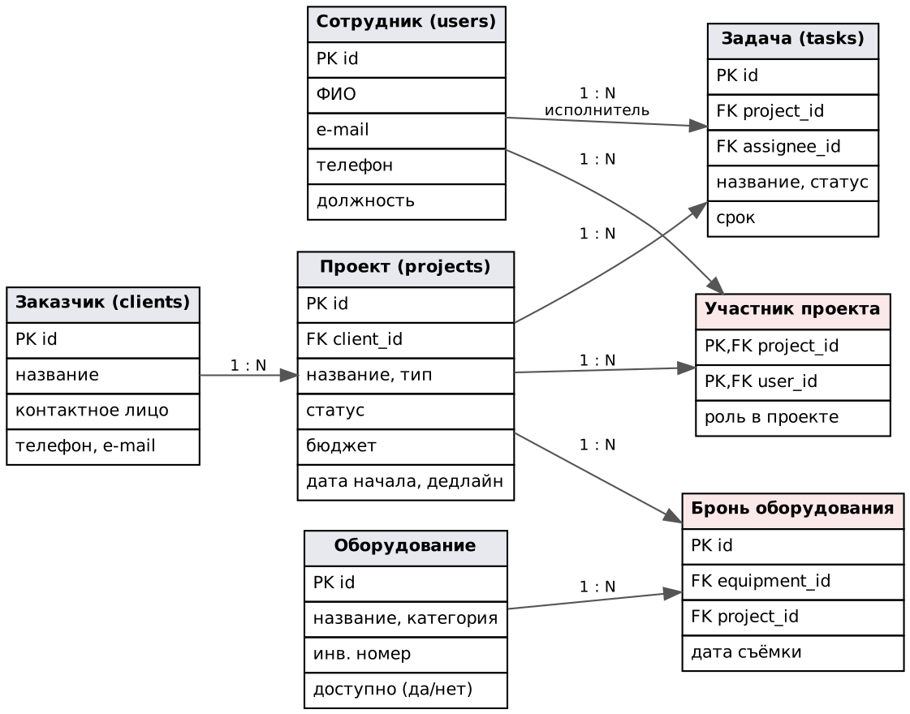

# Цель работы

Определить, какие данные нужны первой версии приложения, выделить сущности, их атрибуты и связи, предварительно задать ключи и построить первую ER-диаграмму.

# 1. Функции, для которых нужно хранить данные

| FR | Функция | Какие данные нужны |
|---|---|---|
| FR-01, FR-02 | Список проектов, фильтр | Проект (название, тип, статус, сроки), заказчик, продюсер, задачи для прогресса |
| FR-03 | Создание проекта | Проект, ссылка на заказчика и сотрудника-продюсера |
| FR-04 | Карточка проекта | Проект, участники группы и их роли, задачи |
| FR-05, FR-06 | Задачи и их статусы | Задача: проект, исполнитель, статус, срок |
| FR-07 | Справочники | Сотрудники, заказчики, оборудование |
| FR-09 | Бронирование оборудования (v2) | Оборудование, проект, время брони |

Бронирование входит во вторую версию, но сущность закладывается сразу, чтобы позже не перестраивать связи проекта.

# 2. Сущности и атрибуты

**Сотрудник (users)** — работник студии, который может быть продюсером, исполнителем задач или участником группы.

| Атрибут | Описание |
|---|---|
| id | Идентификатор |
| ФИО | Полное имя |
| e-mail | Рабочая почта, уникальна |
| телефон | Контактный телефон |
| должность | admin, producer, director, operator, editor |

**Заказчик (clients)** — компания или человек, заказавший видео.

| Атрибут | Описание |
|---|---|
| id | Идентификатор |
| название | Название компании или имя |
| контактное лицо | С кем согласуются материалы |
| телефон, e-mail | Контакты |

**Проект (projects)** — один заказ на производство видео.

| Атрибут | Описание |
|---|---|
| id | Идентификатор |
| название | Например, «Рекламный ролик „Утро с кофе“» |
| заказчик | Ссылка на заказчика |
| тип | Реклама, клип, корпоративное видео, мероприятие, документальное, другое |
| статус | Новый → препродакшн → съёмка → постпродакшн → согласование → сдан / отменён |
| бюджет | Сумма договора, руб. |
| дата начала, дедлайн | Сроки проекта |
| описание | Свободный текст |

**Участник проекта (project_members)** — связь сотрудника с проектом и его роль именно в этом проекте (например, «Оператор-постановщик»).

**Задача (tasks)** — единица работы в проекте: название, статус (к выполнению / в работе / готово), исполнитель, срок.

**Оборудование (equipment)** — камера, объектив, свет, звук, грип: название, категория, инвентарный номер, признак доступности.

**Бронь оборудования (equipment_bookings)** — какая единица оборудования закреплена за каким проектом на какую дату съёмки.

# 3. Связи и кратности

| Связь | Кратность | Пояснение |
|---|---|---|
| Заказчик — Проект | 1 : N | У заказчика может быть много проектов, у проекта ровно один заказчик |
| Проект — Задача | 1 : N | Задачи существуют только внутри проекта |
| Сотрудник — Задача | 1 : N | У задачи не более одного исполнителя, у сотрудника много задач |
| Сотрудник — Проект | N : M | Сотрудник работает в нескольких проектах, в проекте несколько сотрудников |
| Оборудование — Проект | N : M | Одна камера используется в разных проектах в разное время; проекту нужно много оборудования |

**Промежуточные таблицы.** Связи N:M в реляционной модели нельзя хранить напрямую, поэтому вводятся две таблицы:

- **project_members** (проект, сотрудник, роль в проекте) — кроме самой связи хранит атрибут, который принадлежит именно паре «сотрудник–проект»: один и тот же человек в одном проекте режиссёр, а в другом сценарист;
- **equipment_bookings** (оборудование, проект, дата) — связь имеет собственные данные (когда занято оборудование), и одна и та же пара может повторяться на разные даты, поэтому у брони свой идентификатор.

# 4. Предварительные ключи

| Таблица | Первичный ключ | Внешние ключи |
|---|---|---|
| users | id | — |
| clients | id | — |
| projects | id | client_id → clients |
| project_members | (project_id, user_id) | project_id → projects, user_id → users |
| tasks | id | project_id → projects, assignee_id → users |
| equipment | id | — |
| equipment_bookings | id | equipment_id → equipment, project_id → projects |

Используются суррогатные ключи (автоинкремент), потому что естественные атрибуты (название проекта, ФИО) не уникальны и могут меняться. Уникальность естественных значений (e-mail сотрудника, инвентарный номер) будет обеспечена отдельными ограничениями.

# 5. Первая ER-диаграмма и открытые вопросы

**Открытые вопросы о целостности данных:**

1. Как хранить продюсера проекта? Сейчас он определяется только через участников с ролью «Продюсер» — для списка проектов это неудобно и не гарантирует, что продюсер ровно один.
2. Задачи не привязаны к этапу производства — непонятно, как строить доску «препродакшн / съёмка / постпродакшн».
3. Бронь хранит только дату съёмки: нельзя забронировать оборудование на полдня или на несколько дней, и ничто не мешает занять одну камеру дважды на одно время.
4. Что делать с задачами и бронями при удалении проекта, и можно ли удалить заказчика, у которого есть проекты?
5. Признак «доступно» у оборудования дублирует информацию о бронях — нужен ли он?
6. Как ограничить допустимые значения статусов и типов: отдельные справочные таблицы или ограничения CHECK?
7. Должен ли у заказчика быть хотя бы один способ связи?

Ответы на эти вопросы и исправления модели — в ПР №4.

# Вывод

Выделено 7 сущностей, из них 2 — промежуточные таблицы для связей N:M. Описаны атрибуты, кратности связей, предварительные первичные и внешние ключи, построена первая ER-диаграмма и сформулированы 7 вопросов о целостности, которые закрываются в физической схеме.
