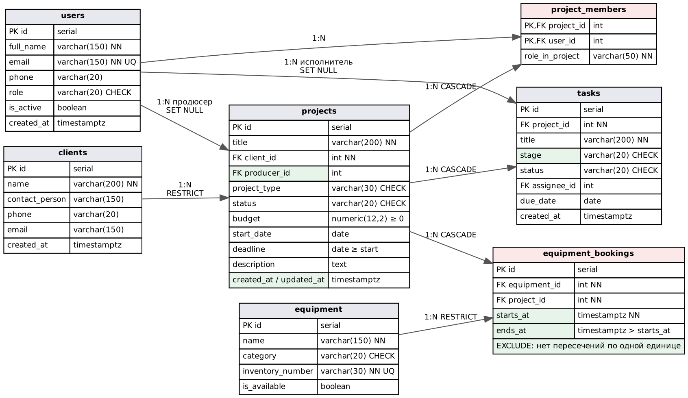

# Цель работы

Доработать логическую модель ПР №3 до физической схемы PostgreSQL: типы, ограничения, индексы, права доступа; написать SQL-скрипты создания и заполнения БД и проверить типовые запросы и ограничения.

# 1. Исправления ER-диаграммы

Новая БД не создавалась — модель ПР №3 доработана по открытым вопросам.

| № | Вопрос ПР №3 | Принятое решение |
|---|---|---|
| 1 | Продюсер через участников | Добавлен внешний ключ `projects.producer_id → users`. Участники группы по-прежнему в `project_members` |
| 2 | Задачи без этапа | Добавлено поле `tasks.stage` (preproduction / shooting / postproduction / review) |
| 3 | Бронь только на дату, возможны накладки | Дата заменена интервалом `starts_at`–`ends_at` (timestamptz). Добавлено ограничение `EXCLUDE USING gist`: одна единица оборудования не может иметь пересекающихся броней |
| 4 | Удаление проекта и заказчика | Задачи, участники и брони удаляются вместе с проектом (`ON DELETE CASCADE`); заказчика с проектами удалить нельзя (`RESTRICT`); при удалении сотрудника его задачи остаются без исполнителя (`SET NULL`) |
| 5 | Признак «доступно» у оборудования | Оставлен как признак «в строю / в ремонте». Занятость определяется только по броням |
| 6 | Статусы и типы | Ограничения `CHECK` со списком значений. Списки короткие и меняются вместе с кодом, отдельные таблицы-справочники не нужны |
| 7 | Контакты заказчика | `CHECK (phone IS NOT NULL OR email IS NOT NULL)` |
| — | Аудит изменений | В `projects` добавлены `created_at`, `updated_at`; `updated_at` обновляет триггер |



# 2. Таблицы, типы и ограничения

Обозначения: NN — NOT NULL, UQ — UNIQUE.

**users**

| Поле | Тип | Ключ | Ограничения |
|---|---|---|---|
| id | serial | PK | |
| full_name | varchar(150) | | NN |
| email | varchar(150) | | NN, UQ |
| phone | varchar(20) | | |
| role | varchar(20) | | NN, DEFAULT 'editor', CHECK (admin, producer, director, operator, editor) |
| is_active | boolean | | NN, DEFAULT true |
| created_at | timestamptz | | NN, DEFAULT now() |

**clients**

| Поле | Тип | Ключ | Ограничения |
|---|---|---|---|
| id | serial | PK | |
| name | varchar(200) | | NN |
| contact_person | varchar(150) | | |
| phone | varchar(20) | | CHECK: phone или email заполнен |
| email | varchar(150) | | |
| created_at | timestamptz | | NN, DEFAULT now() |

**projects**

| Поле | Тип | Ключ | Ограничения |
|---|---|---|---|
| id | serial | PK | |
| title | varchar(200) | | NN |
| client_id | integer | FK → clients | NN, ON DELETE RESTRICT |
| producer_id | integer | FK → users | ON DELETE SET NULL |
| project_type | varchar(30) | | NN, DEFAULT 'commercial', CHECK (список типов) |
| status | varchar(20) | | NN, DEFAULT 'new', CHECK (new … done, cancelled) |
| budget | numeric(12,2) | | NN, DEFAULT 0, CHECK ≥ 0 |
| start_date | date | | |
| deadline | date | | CHECK deadline ≥ start_date |
| description | text | | |
| created_at, updated_at | timestamptz | | NN, DEFAULT now(), триггер |

**project_members**

| Поле | Тип | Ключ | Ограничения |
|---|---|---|---|
| project_id | integer | PK, FK → projects | ON DELETE CASCADE |
| user_id | integer | PK, FK → users | ON DELETE CASCADE |
| role_in_project | varchar(50) | | NN |

**tasks**

| Поле | Тип | Ключ | Ограничения |
|---|---|---|---|
| id | serial | PK | |
| project_id | integer | FK → projects | NN, ON DELETE CASCADE |
| title | varchar(200) | | NN |
| stage | varchar(20) | | NN, DEFAULT 'preproduction', CHECK |
| status | varchar(20) | | NN, DEFAULT 'todo', CHECK (todo, in_progress, done) |
| assignee_id | integer | FK → users | ON DELETE SET NULL |
| due_date | date | | |
| created_at | timestamptz | | NN, DEFAULT now() |

**equipment**

| Поле | Тип | Ключ | Ограничения |
|---|---|---|---|
| id | serial | PK | |
| name | varchar(150) | | NN |
| category | varchar(20) | | NN, CHECK (camera, lens, light, sound, grip, other) |
| inventory_number | varchar(30) | | NN, UQ |
| is_available | boolean | | NN, DEFAULT true |

**equipment_bookings**

| Поле | Тип | Ключ | Ограничения |
|---|---|---|---|
| id | serial | PK | |
| equipment_id | integer | FK → equipment | NN, ON DELETE RESTRICT |
| project_id | integer | FK → projects | NN, ON DELETE CASCADE |
| starts_at | timestamptz | | NN |
| ends_at | timestamptz | | NN, CHECK ends_at > starts_at |
| — | — | | EXCLUDE USING gist (equipment_id WITH =, tstzrange(starts_at, ends_at) WITH &&) |

# 3. Нормализация, индексы и права доступа

**Нормализация.** Схема находится в третьей нормальной форме: все атрибуты атомарны (1НФ); в таблицах с составным ключом (`project_members`) неключевой атрибут `role_in_project` зависит от всего ключа (2НФ); транзитивных зависимостей нет — данные заказчика и сотрудника не копируются в проект, а берутся по внешнему ключу (3НФ).

**Денормализация** сознательно не применяется. Прогресс проекта (выполнено/всего задач) не хранится, а считается запросом с `count(...) FILTER (...)`: при текущих объёмах это быстро (см. раздел 5), и нет риска рассинхронизации счётчика с задачами. Если при росте данных это станет узким местом, вернёмся к вопросу в ПР №23.

**Индексы.** PostgreSQL автоматически индексирует первичные ключи и UNIQUE. Дополнительно созданы индексы под реальные запросы приложения:

| Индекс | Для какого запроса |
|---|---|
| `idx_projects_status` | фильтр списка по статусу (FR-02) |
| `idx_projects_client`, `idx_projects_producer` | соединение проектов с заказчиком и продюсером, проверка RESTRICT при удалении |
| `idx_tasks_project` | задачи проекта и подсчёт прогресса (FR-01, FR-04) |
| `idx_tasks_assignee` | задачи сотрудника, отчёт о загрузке (FR-12) |
| `idx_members_user` | проекты сотрудника (второй столбец составного PK) |
| `idx_bookings_project` | брони проекта; поиск по оборудованию и времени обслуживает GiST-индекс ограничения EXCLUDE |

**Права доступа.** Владелец схемы (`studio_owner`) используется только для создания таблиц и миграций. Приложение подключается отдельной ролью `studio_app` (скрипт `db/03_app_role.sh`), у которой есть только `SELECT, INSERT, UPDATE, DELETE` на таблицы и право использовать последовательности; создавать и удалять таблицы она не может, право `CREATE` в схеме `public` отозвано. Пароль роли задаётся переменной среды, в скриптах его нет.

# 4. SQL-скрипты

Скрипты лежат в репозитории в папке `db/`:

- `01_schema.sql` — создание расширения `btree_gist`, 7 таблиц, ограничений, индексов и триггера;
- `02_seed.sql` — тестовые данные: 6 сотрудников, 3 заказчика, 4 проекта, 9 участников, 9 задач, 6 единиц оборудования, 3 брони;
- `03_app_role.sh` — роль приложения с минимальными правами;
- `04_checks.sql` — проверочные запросы.

Фрагмент `01_schema.sql` (таблица броней):

```sql
CREATE TABLE equipment_bookings (
    id            SERIAL PRIMARY KEY,
    equipment_id  INTEGER     NOT NULL REFERENCES equipment(id) ON DELETE RESTRICT,
    project_id    INTEGER     NOT NULL REFERENCES projects(id) ON DELETE CASCADE,
    starts_at     TIMESTAMPTZ NOT NULL,
    ends_at       TIMESTAMPTZ NOT NULL,
    CONSTRAINT bookings_period_chk CHECK (ends_at > starts_at),
    CONSTRAINT bookings_no_overlap EXCLUDE USING gist (
        equipment_id WITH =,
        tstzrange(starts_at, ends_at) WITH &&
    )
);
```

Фрагмент `02_seed.sql`:

```sql
INSERT INTO projects (title, client_id, producer_id, project_type, status, budget, start_date, deadline, description) VALUES
 ('Рекламный ролик «Утро с кофе»', 1, 2, 'commercial', 'shooting', 350000, '2026-10-01', '2026-11-15', '30-секундный ролик для ТВ и соцсетей'),
 ('Клип «Ветер перемен»', 2, 6, 'music_video', 'preproduction', 220000, '2026-10-20', '2026-12-10', 'Клип на новый сингл');
```

Создание БД: `createdb studio && psql -d studio -f db/01_schema.sql -f db/02_seed.sql`.

# 5. Проверка запросов, связей и ограничений

Запуск: `psql -d studio -f db/04_checks.sql` (PostgreSQL 16.15).

**Запрос 1. Проекты с заказчиком и продюсером (JOIN трёх таблиц)**

```
 id | title                           | client                     | producer                  | status         | deadline
  3 | Корпоративный фильм к 25-летию  | АО «ТехноПром»             | Кузнецов Дмитрий Игоревич | postproduction | 2026-11-01
  1 | Рекламный ролик «Утро с кофе»   | ООО «Северный кофе»        | Кузнецов Дмитрий Игоревич | shooting       | 2026-11-15
  2 | Клип «Ветер перемен»            | Музыкальная группа «Ветер» | Лебедева Ксения Романовна | preproduction  | 2026-12-10
  4 | Тизер выставки «ТехноПром-2027» | АО «ТехноПром»             | Лебедева Ксения Романовна | new            | 2027-01-20
```

**Запрос 2. Прогресс задач по проектам (агрегат с FILTER)**

```
 title                           | total | done | pct
 Рекламный ролик «Утро с кофе»   |     4 |    2 |  50
 Клип «Ветер перемен»            |     2 |    0 |   0
 Корпоративный фильм к 25-летию  |     3 |    0 |   0
 Тизер выставки «ТехноПром-2027» |     0 |    0 |
```

**Запрос 3. Нагрузка сотрудников (открытые задачи)** — у монтажёра Волкова А. Д. 3 открытые задачи, у остальных по одной, у администратора 0.

**Запрос 4. Занятость оборудования 25.10.2026 (пересечение интервалов `&&`)** — заняты CAM-001 (Sony FX6) и LGT-001 (Aputure 600d Pro) под проект «Утро с кофе».

**Проверка ограничений** (каждая команда должна быть отклонена):

| № | Действие | Ожидание | Результат |
|---|---|---|---|
| 1 | Проект со статусом `unknown` | Ошибка CHECK | `violates check constraint "projects_status_check"` ✔ |
| 2 | Проект с заказчиком 999 | Ошибка FK | `violates foreign key constraint "projects_client_id_fkey"` ✔ |
| 3 | Дедлайн 01.11 раньше начала 01.12 | Ошибка CHECK | `violates check constraint "projects_dates_chk"` ✔ |
| 4 | Второй сотрудник с e-mail orlova@studio.local | Ошибка UNIQUE | `duplicate key value violates unique constraint "users_email_key"` ✔ |
| 5 | Бронь CAM-001 25.10 18:00–22:00 (пересекается с 08:00–20:00) | Ошибка EXCLUDE | `conflicting key value violates exclusion constraint "bookings_no_overlap"` ✔ |
| 6 | Удалить заказчика 1, у которого есть проекты | Ошибка RESTRICT | `violates foreign key constraint ... is still referenced from table "projects"` ✔ |
| 7 | Бюджет −1 | Ошибка CHECK | `violates check constraint "projects_budget_check"` ✔ |
| 8 | Удалить проект 2 (в транзакции с ROLLBACK) | Задачи удаляются каскадно | задач до: 2, после: 0 ✔ |
| 9 | Роль `studio_app`: `CREATE TABLE`, `DROP TABLE tasks` | Отказ | `permission denied for schema public`, `must be owner of table tasks` ✔ |

Все ограничения сработали так, как задумано: некорректные данные не попадают в БД даже в обход приложения.

# Вывод

Логическая модель доработана по 7 открытым вопросам, получена физическая схема из 7 таблиц в 3НФ с ограничениями NOT NULL, UNIQUE, CHECK, FK с правилами удаления и EXCLUDE против накладок в бронях. Созданы индексы под запросы приложения и роль с минимальными правами. SQL-скрипты создания, заполнения и проверки выполнены, все 9 проверок ограничений дали ожидаемый результат.
