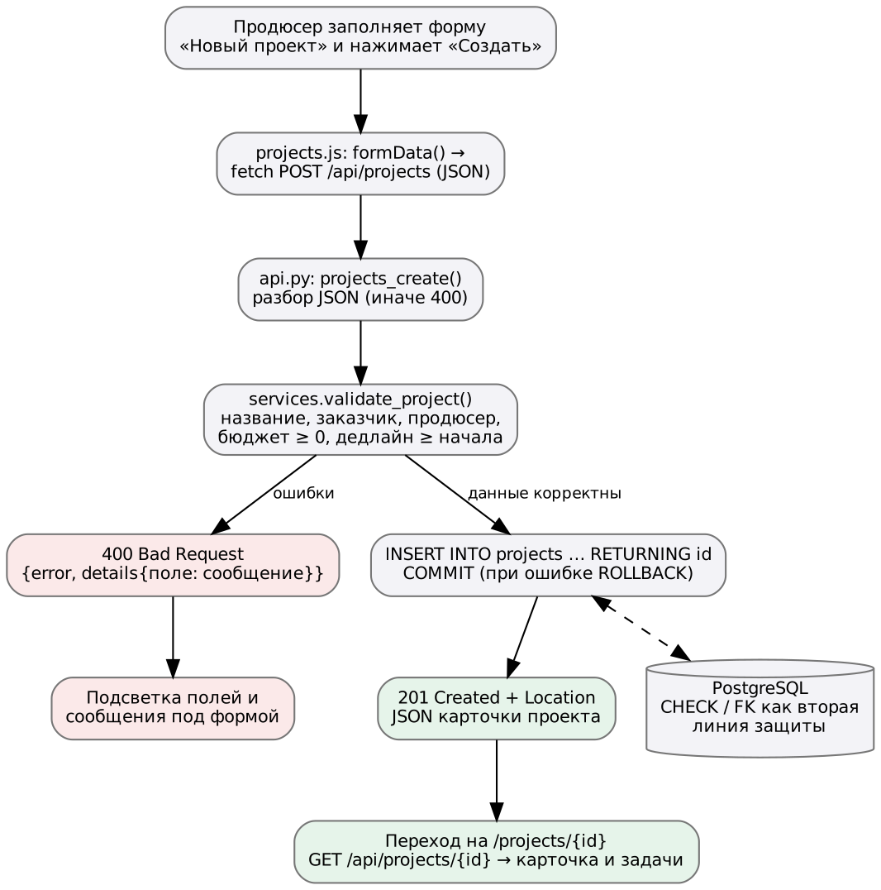
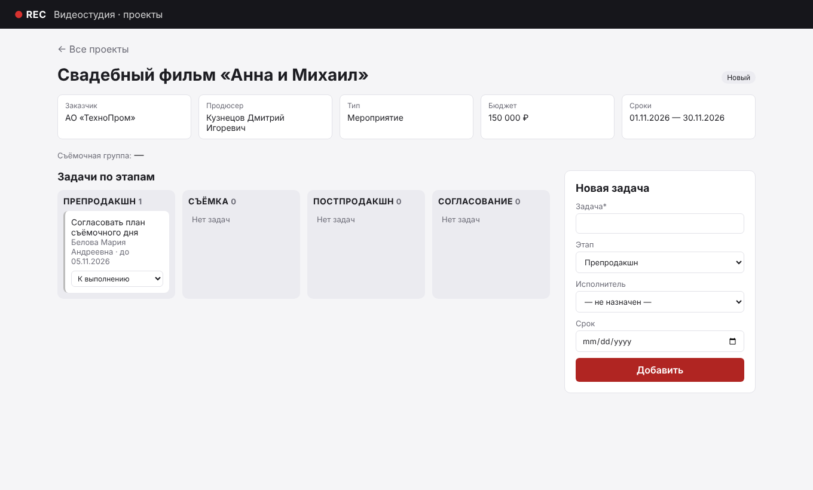
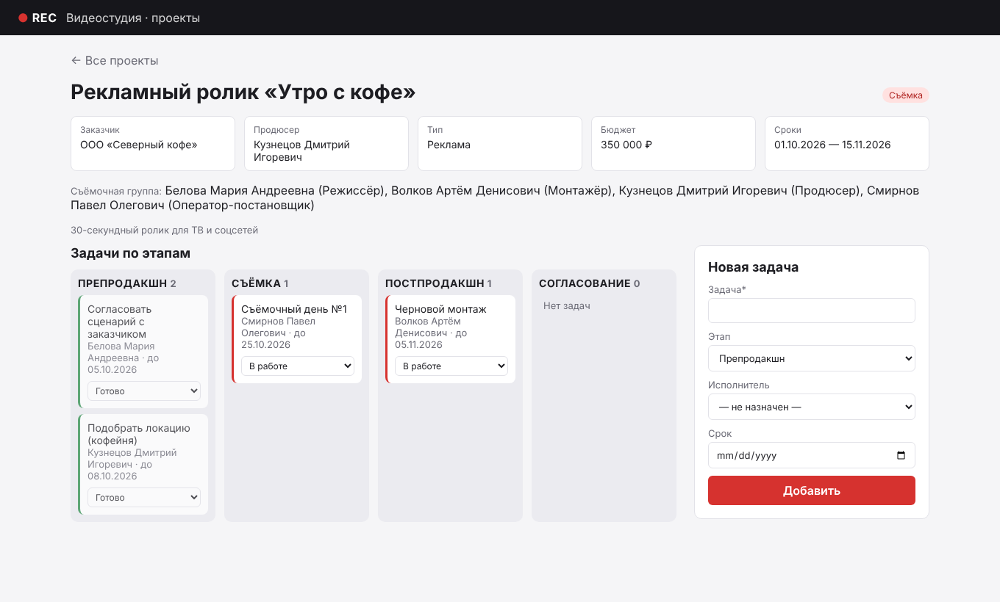
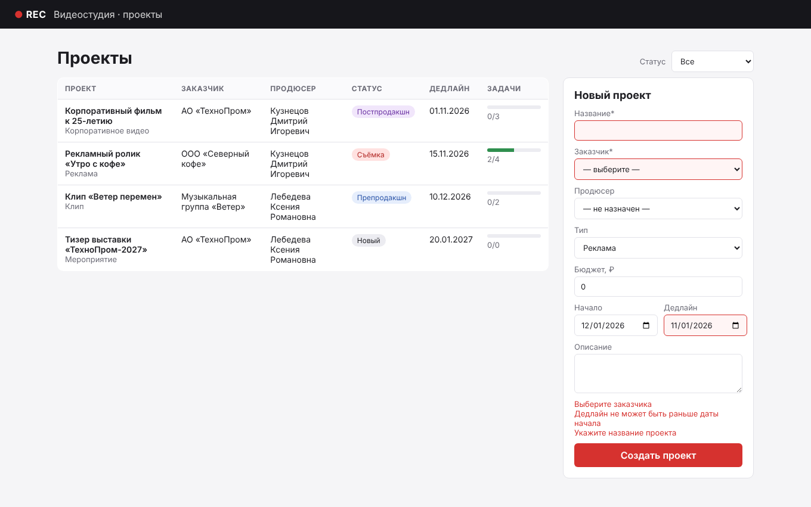

# Цель работы

Продолжить каркас ПР №5 и довести до рабочего состояния пользовательский сценарий MVP «Продюсер создаёт проект и ведёт его задачи»: форма → сервер → БД → ответ → обновление интерфейса.

# 1. Схема «клиент → сервер → БД» для сценария



| Шаг | Где | Что происходит |
|---|---|---|
| 1 | Браузер, `projects.js` | Пользователь заполняет форму, обработчик `submit` собирает поля в JSON и отправляет `POST /api/projects`; кнопка блокируется от двойного нажатия |
| 2 | `api.py` | Маршрут проверяет, что тело — JSON-объект, и передаёт данные в сервис |
| 3 | `services.py` | `validate_project()` проверяет все поля и существование заказчика и продюсера в БД |
| 4 | `db.py` → PostgreSQL | `INSERT ... RETURNING id`, фиксация транзакции; ограничения CHECK/FK — вторая линия защиты |
| 5 | `api.py` | Ответ `201 Created` с заголовком `Location` и JSON карточки проекта |
| 6 | Браузер | Переход на `/projects/{id}`; страница запрашивает `GET /api/projects/{id}` и показывает данные |
| 6а | Браузер (ошибка) | При `400` поля из `details` подсвечиваются, под формой выводятся сообщения |

Дальше в карточке проекта сценарий продолжается: добавление задачи (`POST /api/projects/{id}/tasks`) и смена её статуса (`PATCH /api/tasks/{id}`) по той же схеме.

# 2. Реализация формы, кнопки и списка

**Отправка формы** (`app/static/js/projects.js`):

```javascript
form.addEventListener("submit", async (e) => {
  e.preventDefault();
  const button = form.querySelector("button");
  button.disabled = true;
  try {
    const project = await api("/projects", { method: "POST", body: formData(form) });
    window.location.href = `/projects/${project.id}`;
  } catch (err) {
    showErrors(form, errorsEl, err);     // подсветка полей и сообщения сервера
  } finally {
    button.disabled = false;
  }
});
```

**Общая функция запроса** (`common.js`) превращает любой ответ с кодом не 2xx в исключение `ApiError` с полями `status` и `details`, а сетевую ошибку — в сообщение «Сервер недоступен».

**Элементы интерфейса сценария:**

- форма «Новый проект» с выпадающими списками заказчиков и продюсеров, которые заполняются из `GET /api/clients` и `GET /api/users?role=producer`;
- таблица проектов с бейджем статуса и полосой прогресса задач;
- доска задач из четырёх колонок по этапам производства;
- форма «Новая задача» и выпадающий список статуса на каждой карточке задачи (при изменении сразу отправляется `PATCH`).

Пользовательский текст выводится через `textContent` или экранируется функцией `escapeHtml()`, чтобы название проекта вида `<script>` не выполнилось как код.

# 3. Чтение и сохранение данных через сервер

Браузер не имеет доступа к БД: все операции идут через REST API, а SQL выполняется только на сервере.

| Действие в интерфейсе | Запрос | Таблицы БД |
|---|---|---|
| Открыть список | `GET /api/projects?status=` | projects, clients, users, tasks (SELECT) |
| Создать проект | `POST /api/projects` | projects (INSERT) |
| Открыть карточку | `GET /api/projects/{id}` | projects, tasks, project_members, users (SELECT) |
| Добавить задачу | `POST /api/projects/{id}/tasks` | tasks (INSERT) |
| Сменить статус задачи | `PATCH /api/tasks/{id}` | tasks (UPDATE) |

Фактический обмен для успешного создания:

```
POST /api/projects
{"title":"Промо-ролик фестиваля","client_id":2,"producer_id":6,"project_type":"event",
 "budget":180000,"start_date":"2026-11-10","deadline":"2026-12-01"}

HTTP/1.1 201 CREATED
Location: /api/projects/6
{"id":6,"title":"Промо-ролик фестиваля","status":"new","budget":180000.0,
 "client_name":"Музыкальная группа «Ветер»","producer_name":"Лебедева Ксения Романовна",
 "tasks":[],"members":[],"tasks_total":0,"tasks_done":0, ...}
```

Добавление задачи и смена статуса:

```
POST /api/projects/1/tasks  {"title":"Озвучка диктором","stage":"postproduction","assignee_id":5,"due_date":"2026-11-07"}
HTTP/1.1 201 CREATED  {"id":11,"status":"todo","assignee_name":"Волков Артём Денисович", ...}

PATCH /api/tasks/3  {"status":"done"}
HTTP/1.1 200 OK       {"id":3,"title":"Съёмочный день №1","status":"done", ...}
```





# 4. Проверка корректного и ошибочного ввода

**Ручные проверки через интерфейс и curl:**

| № | Ввод | Ожидание | Результат |
|---|---|---|---|
| 1 | Все поля корректны | 201, переход в карточку | ✔ |
| 2 | Пустое название (или из пробелов) | 400, «Укажите название проекта» | ✔ |
| 3 | Заказчик не выбран | 400, «Выберите заказчика» | ✔ |
| 4 | `client_id: "abc"` | 400, «Ожидается целое число» | ✔ |
| 5 | Бюджет −100 | 400, «Бюджет не может быть отрицательным» | ✔ |
| 6 | Дедлайн 01.11.2026 при начале 01.12.2026 | 400, «Дедлайн не может быть раньше даты начала» | ✔ |
| 7 | Продюсером выбран монтажёр (id 5) | 400, «Продюсер не найден» | ✔ |
| 8 | Тело запроса не JSON | 400, «Ожидается JSON-объект» | ✔ |
| 9 | Задача в несуществующий проект 999 | 404, «Проект не найден» | ✔ |
| 10 | Статус задачи `closed` | 400, список допустимых значений | ✔ |
| 11 | Название `<b>тест</b>` | Отображается как текст, а не HTML | ✔ |



**Автотесты** (`tests/test_api.py`, pytest, отдельная БД пересоздаётся перед каждым тестом): 14 тестов покрывают список, фильтр, карточку, создание проекта, все ветки валидации, задачи и ошибки 404.

```
$ pytest -q
..............                                                           [100%]
14 passed in 1.71s
```

**Найденные и исправленные дефекты:**

| № | Дефект | Как обнаружен | Исправление |
|---|---|---|---|
| D-1 | При пустом заказчике выводилось обезличенное «Обязательное поле» — непонятно, к какому полю относится | Ручная проверка формы | Сообщение заменено на «Выберите заказчика» |
| D-2 | Длинный список участников группы растягивал по высоте все плитки карточки проекта | Просмотр скриншота | Группа вынесена отдельной строкой под плитками |
| D-3 | Описание проекта загружалось вторым SQL-запросом в карточке | Ревью кода | Поле добавлено в основной запрос, лишний запрос удалён |
| D-4 | Неизвестный путь `/api/...` возвращал английское «Not Found» | Проверка curl | Для 404/405 в API выводятся русские сообщения |

# 5. Что готово и что осталось

| FR | Требование | Статус |
|---|---|---|
| FR-01 | Список проектов с прогрессом | ✔ закрыто полностью |
| FR-02 | Фильтр по статусу | ✔ закрыто полностью |
| FR-03 | Создание проекта с проверкой | ✔ закрыто полностью |
| FR-04 | Карточка проекта | ✔ закрыто полностью (просмотр группы; редактирование — FR-10) |
| FR-05 | Добавление задачи | ✔ закрыто полностью |
| FR-06 | Смена статуса задачи | ✔ закрыто полностью |
| FR-07 | Справочники | ◐ частично: только чтение через API, без экранов редактирования |
| FR-08 … FR-12 | Этапы проекта, брони, группа, вход, отчёты | ○ запланированы на вторую версию (структура БД для FR-08, FR-09, FR-10 уже готова) |

**Осталось:** редактирование и удаление проекта, смена этапа проекта с правилами, интерфейс бронирования оборудования, аутентификация.

# Вывод

Сценарий MVP «создать проект и вести его задачи» работает от формы в браузере до записи в PostgreSQL и обратно. Проверены корректный и 10 вариантов ошибочного ввода, 14 автотестов проходят, найдены и исправлены 4 дефекта. Полностью закрыты FR-01 – FR-06, частично FR-07.
