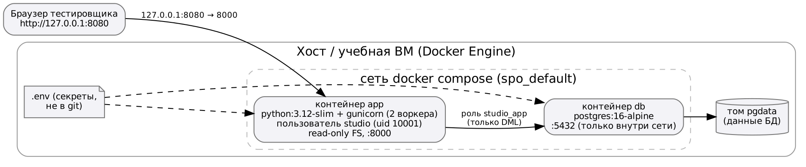

# Цель работы

Развернуть текущий MVP в тестовом окружении (контейнеры Docker на учебной машине), описать зависимости, переменные среды, порядок получения кода и подключения к БД, проверить сценарий и зафиксировать ошибки развёртывания.

# 1. Выбор и схема окружения

**Выбор:** Docker Compose на учебной машине/ВМ (Linux, Docker Engine 29). Альтернативы — ручная установка на ВМ (долго и трудно повторить) и публичный хостинг (на этом этапе не обязателен). Контейнеры дают одинаковое окружение на любом компьютере и запуск одной командой.



| | Среда разработки | Тестовое окружение |
|---|---|---|
| Запуск приложения | `flask run` (встроенный сервер Werkzeug, отладка) | gunicorn, 2 процесса-обработчика, в контейнере |
| Python | локальный интерпретатор | образ `python:3.12-slim` |
| БД | локальный PostgreSQL, БД создаётся вручную | контейнер `postgres:16-alpine`, схема и данные применяются автоматически при первом запуске |
| Данные БД | локальный каталог PostgreSQL | именованный том `pgdata`, переживает пересоздание контейнеров |
| Конфигурация | переменные в терминале | файл `.env`, передаётся в контейнеры через compose |
| Адрес | http://127.0.0.1:5000 | http://127.0.0.1:8080 |

# 2. Зависимости, переменные среды, запуск

**Зависимости:** на машине — Docker Engine и Docker Compose v2, git. Внутри образа — пакеты из `requirements.txt` с закреплёнными версиями (Flask 3.0.3, psycopg2-binary 2.9.9, gunicorn 22.0.0).

**Переменные среды** (значения задаются в `.env`, шаблон — `.env.example`):

| Переменная | Назначение |
|---|---|
| `POSTGRES_DB` | имя БД (studio) |
| `POSTGRES_USER`, `POSTGRES_PASSWORD` | владелец БД, создаётся контейнером postgres |
| `DATABASE_URL` | строка подключения приложения (формируется в compose из переменных выше) |
| `SECRET_KEY` | секретный ключ Flask |
| `APP_PORT` | порт на хосте (по умолчанию 8080) |
| `LOG_LEVEL` | уровень журналирования (INFO) |

**Dockerfile** (первая версия):

```dockerfile
FROM python:3.12-slim
WORKDIR /srv/app
COPY requirements.txt .
RUN pip install --no-cache-dir -r requirements.txt
COPY app ./app
COPY wsgi.py gunicorn.conf.py ./
EXPOSE 8000
CMD ["gunicorn", "-c", "gunicorn.conf.py", "wsgi:app"]
```

**docker-compose.yml** (первая версия):

```yaml
services:
  db:
    image: postgres:16-alpine
    environment:
      POSTGRES_DB: ${POSTGRES_DB}
      POSTGRES_USER: ${POSTGRES_USER}
      POSTGRES_PASSWORD: ${POSTGRES_PASSWORD}
    volumes:
      - pgdata:/var/lib/postgresql/data
      - ./db/01_schema.sql:/docker-entrypoint-initdb.d/01_schema.sql:ro
      - ./db/02_seed.sql:/docker-entrypoint-initdb.d/02_seed.sql:ro
  app:
    build: .
    depends_on: [db]
    environment:
      DATABASE_URL: postgresql://${POSTGRES_USER}:${POSTGRES_PASSWORD}@db:5432/${POSTGRES_DB}
    ports:
      - "8080:8000"
volumes:
  pgdata:
```

**Команды запуска:**

```bash
cp .env.example .env          # задать свои пароли
docker compose up -d --build  # сборка образа и запуск
docker compose ps             # состояние контейнеров
docker compose logs -f app    # журнал приложения
docker compose down           # остановка (данные в томе сохраняются)
```

# 3. Подключение к учебной БД и получение исходного кода

**Исходный код** берётся из репозитория:

```bash
git clone https://github.com/Nekithogogo/spo.git
cd spo
git pull                       # обновление до последней версии main
```

**БД.** При первом запуске пустого тома контейнер postgres выполняет скрипты из `/docker-entrypoint-initdb.d` по алфавиту: `01_schema.sql` (таблицы из ПР №4), затем `02_seed.sql` (тестовые данные). Приложение обращается к БД по имени сервиса `db` во внутренней сети compose. Для ручной работы с БД:

```bash
docker compose exec db psql -U studio_owner -d studio
```

При повторных запусках скрипты не выполняются — данные берутся из тома `pgdata`. Чтобы пересоздать БД с нуля: `docker compose down -v && docker compose up -d`.

# 4. Адрес запуска и проверка сценария

Адрес тестового запуска: **http://127.0.0.1:8080** (API: http://127.0.0.1:8080/api/...).

```
$ docker compose ps
NAME        IMAGE                COMMAND                  SERVICE   STATUS         PORTS
spo-app-1   spo-app              "gunicorn -c gunicor…"   app       Up             0.0.0.0:8080->8000/tcp
spo-db-1    postgres:16-alpine   "docker-entrypoint.s…"   db        Up             0.0.0.0:5432->5432/tcp

$ curl -i http://127.0.0.1:8080/api/health
HTTP/1.1 200 OK
Server: gunicorn
{"db":"ok","status":"ok"}
```

**Проверка сценария MVP «создать проект и вести задачи»** в тестовом окружении:

| Шаг | Результат |
|---|---|
| Открыть http://127.0.0.1:8080/ | список из 4 тестовых проектов ✔ |
| `POST /api/projects` с проектом «Тест деплоя» | `201`, проект появился в списке ✔ |
| Открыть карточку, добавить задачу, сменить статус | изменения сохраняются, прогресс пересчитан ✔ |
| `docker compose down && docker compose up -d` | созданный проект на месте (данные в томе) ✔ |

Для повторяемой проверки добавлен скрипт `deploy/smoke.sh`:

```
$ ./deploy/smoke.sh http://127.0.0.1:8080
OK   health (200)
OK   главная страница (200)
OK   список проектов (200)
OK   карточка проекта (200)
OK   несуществующий проект (404)
OK   создание с ошибкой валидации (400)
```

Время ответа на стенде (20 запросов): `GET /api/projects` — медиана 23,8 мс, `GET /api/projects/1` — 22,9 мс; при 105 проектах — 22,3 мс, что укладывается в NFR-01 (≤ 500 мс).

# 5. Ошибки развёртывания и их устранение

| № | Ошибка | Причина | Устранение |
|---|---|---|---|
| E-1 | `failed to resolve reference "docker.io/library/postgres:16-alpine": 429 Too Many Requests` | Ограничение числа анонимных загрузок с Docker Hub для общего IP учебной сети | Образы загружены через зеркало `mirror.gcr.io/library/...` и помечены исходными именами (`docker tag`); альтернатива — `docker login` |
| E-2 | Сборка образа падала на `pip install` (`exit code: 1`) | Внутри сборки нет доступа к PyPI: сеть учебного стенда работает через прокси | Пакеты заранее скачаны на хосте (`pip download`) и установлены в образ из локального каталога; при наличии прокси — передать его через `--build-arg` |
| E-3 | `Bind for 0.0.0.0:5432 failed: port is already allocated` (риск при публикации порта БД) | На хосте уже работает локальный PostgreSQL среды разработки | Порт БД наружу не публикуется: приложению он нужен только внутри сети compose (исправлено в ПР №8) |
| E-4 | Риск: приложение стартует раньше, чем PostgreSQL готов принимать соединения, и первые запросы получают 503 | `depends_on` ждёт только запуска контейнера, а не готовности PostgreSQL | В ПР №8 добавлены `healthcheck` для БД и `condition: service_healthy` |

# Вывод

MVP развёрнут в тестовом окружении Docker Compose (приложение на gunicorn + PostgreSQL 16 с томом данных), запускается одной командой и доступен по адресу http://127.0.0.1:8080. Сценарий создания проекта и задач проверен вручную и smoke-скриптом. Зафиксированы 4 ошибки развёртывания и способы их устранения; укрепление конфигурации — в ПР №8.
