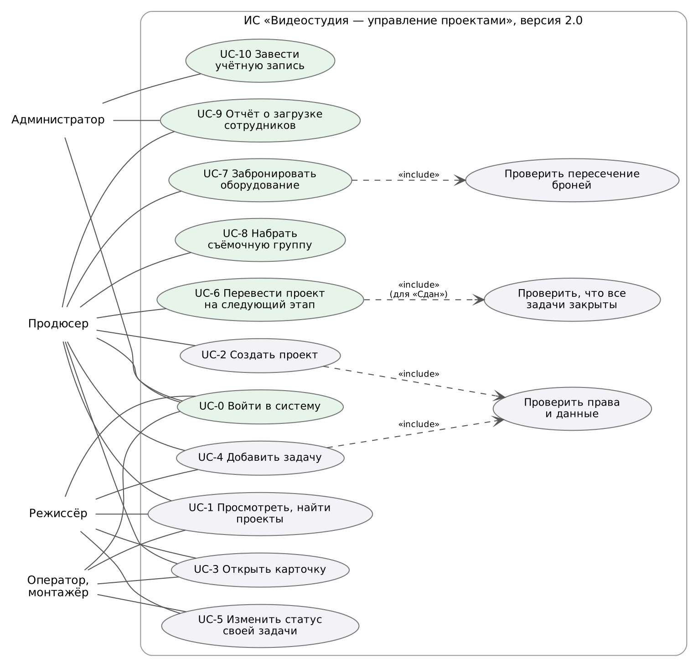

# Цель работы

Пересмотреть требования к ИС «Видеостудия/продакшн — управление проектами» по итогам первой версии (ПР №1–8), уточнить функциональные и нефункциональные требования для версии 2.0, описать новые сценарии использования и составить план разработки этапа III с учётом зависимостей, рисков и будущего масштабирования.

# 1. Итоги версии 1.0 и источники новых требований

Версия 1.0 (MVP) закрыла требования FR-01…FR-07: список проектов, создание проекта с проверкой данных, карточка проекта, задачи по этапам и справочники. Тестовое окружение работает в Docker Compose, 14 автотестов проходят.

Для ревизии требований использовались четыре источника:

| Метод сбора | Что сделано | Что выявлено |
|---|---|---|
| Демонстрация MVP «заказчику» (роль продюсера) | Пройден сценарий от создания проекта до закрытия задач | Нужен перевод проекта по этапам, нельзя «сдать» проект с открытыми задачами |
| Анализ отложенных требований (C/S) из ПР №2 | Пересмотрены FR-08…FR-12 | Вход и роли стали обязательными: без них систему нельзя выставлять в сеть |
| Разбор замечаний ПР №7–8 | Журналы, отказ БД, перезапуск | Нужны мониторинг, резервные копии, HTTPS |
| Анализ данных схемы БД | Таблицы `equipment_bookings` и `project_members` есть, но API к ним нет | Бронирование и группа реализуются без смены модели, только API и интерфейс |

Требования документируются в таблицах (ID, формулировка, критерий проверки, приоритет MoSCoW, версия), сценарии — текстом и диаграммой вариантов использования. Каждое требование получает проверяемый критерий, по которому потом пишется автотест.

# 2. Функциональные требования версии 2.0

Требования FR-01…FR-07 остаются без изменений (API версии 1.0 должно работать как прежде). Ниже — новые и пересмотренные.

| ID | Требование | Критерий проверки | Приоритет | Было |
|---|---|---|---|---|
| FR-08 | Перевод проекта по этапам производства по правилам | Разрешены только переходы из таблицы раздела 4; перевод в «Сдан» при незакрытых задачах отклоняется (409) | M | S, v2 |
| FR-09 | Бронирование оборудования без пересечений | Пересекающаяся бронь той же единицы отклоняется (409) с указанием конфликта, стык интервалов допустим | M | C, v2 |
| FR-10 | Управление съёмочной группой | Добавление сотрудника с ролью, смена роли, исключение; повторное добавление не создаёт дубль | S | C, v2 |
| FR-11 | Вход в систему и права по ролям | Без входа API отвечает 401; монтажёр не может создать проект (403); продюсер меняет только свои проекты | M | S, v2 |
| FR-12 | Отчёт о загрузке сотрудников | Для каждого сотрудника: открытые, текущие, просроченные задачи и число проектов | S | C, v2 |
| FR-13 | История смены статусов проекта | Каждое изменение статуса сохраняется с автором, временем и комментарием | S | новое |
| FR-14 | Поиск и постраничный вывод проектов | Поиск по подстроке названия, `limit`/`offset`, общее число в заголовке `X-Total-Count` | S | новое |
| FR-15 | Редактирование и удаление задач | Продюсер проекта меняет любые поля, исполнитель — только статус своей задачи | S | новое |
| FR-16 | Документация API | Спецификация OpenAPI 3.0 описывает все маршруты, интерактивная страница `/api/docs` | M | новое |
| FR-17 | Учётные записи сотрудников | Администратор создаёт сотрудника с паролем; пароль хранится только в виде хеша | S | новое |

# 3. Нефункциональные требования версии 2.0

| ID | Требование | Измеримый критерий |
|---|---|---|
| NFR-01 | Производительность | Медиана ответа `GET /api/projects` ≤ 500 мс, 95-й перцентиль ≤ 500 мс при 8 параллельных клиентах |
| NFR-03 | Корректность ввода | 100 % входных данных проверяются на сервере, ошибки 400 с сообщением по каждому полю, неизвестные поля отклоняются |
| NFR-05 | Безопасность | Пароли — хеш scrypt; токены подписаны и истекают через 8 ч; защита от перебора: 5 неудачных входов на e-mail за 15 мин; HTTPS; заголовки CSP, HSTS, X-Frame-Options |
| NFR-06 | Развёртываемость | Выпуск новой версии одной командой с автоматическим откатом при провале проверки |
| NFR-07 | Тестируемость | Не менее 50 автотестов; тесты версии 1.0 проходят без изменений (обратная совместимость) |
| NFR-08 | Надёжность | Приложение поднимается после аварийного завершения ≤ 30 с; отказ БД не роняет приложение (ответ 503), после восстановления БД работа продолжается без перезапуска |
| NFR-09 | Сопровождаемость схемы БД | Любое изменение схемы — пронумерованная миграция, применяется автоматически, повторный запуск безопасен |
| NFR-10 | Наблюдаемость | Журнал в JSON с идентификатором запроса, метрики Prometheus, оповещения о недоступности приложения и БД |
| NFR-11 | Восстановимость | Ежедневная резервная копия БД; RPO ≤ 24 ч, RTO ≤ 15 мин; процедура восстановления проверена |

# 4. Сценарии использования версии 2.0

**UC-0. Вход в систему.** Актор: любой сотрудник. Сотрудник вводит e-mail и пароль, система проверяет учётную запись и выдаёт токен на 8 часов; интерфейс показывает имя и роль. Ошибка: неверный пароль — «Неверный e-mail или пароль» (одинаково для несуществующего e-mail); после 5 ошибок вход по этому e-mail блокируется на 15 минут.

**UC-6. Перевод проекта на следующий этап.** Актор: продюсер проекта или администратор. В карточке выбирается один из разрешённых статусов и, при желании, комментарий. Система проверяет правило перехода, сохраняет статус и запись истории. Альтернатива: перевод в «Сдан» при открытых задачах — отказ с числом незакрытых задач.

| Из статуса | Можно перейти |
|---|---|
| Новый | Препродакшн, Отменён |
| Препродакшн | Съёмка, Отменён |
| Съёмка | Постпродакшн, Препродакшн (пересъёмка), Отменён |
| Постпродакшн | Согласование, Съёмка (досъёмка), Отменён |
| Согласование | Сдан (все задачи закрыты), Постпродакшн (правки), Отменён |
| Сдан | — (конечный) |
| Отменён | Новый (возобновление) |

**UC-7. Бронирование оборудования.** Актор: продюсер. Выбирается единица оборудования и интервал «с — по». Система проверяет, что единица в работе, интервал корректен и не пересекается с другими бронями. Ошибка: пересечение — сообщение с названием проекта, который уже занял оборудование.

**UC-8. Набор съёмочной группы.** Актор: продюсер. Выбирает сотрудника и вводит его роль в проекте; повторное добавление меняет роль. Исключение из группы — кнопкой в списке.

**UC-9. Отчёт о загрузке.** Актор: продюсер, администратор. Таблица сотрудников по убыванию числа открытых задач, просроченные выделены.

**UC-5 (изменён). Изменение статуса своей задачи.** Оператор и монтажёр меняют статус только тех задач, где они исполнители; остальные поля задачи им недоступны.

# 5. Ограничения и решения по архитектуре

Архитектура остаётся монолитной (Flask + PostgreSQL), меняется только её окружение:

- аутентификация по токену Bearer, а не по cookie: интерфейс и внешние клиенты используют один и тот же API, защита от CSRF не нужна;
- правила (переходы статусов, пересечение броней) проверяются и в приложении (понятные сообщения), и в БД (ограничения `CHECK`, `EXCLUDE`) — БД защищает данные при одновременных запросах;
- перед приложением ставится обратный прокси nginx: HTTPS, ограничение частоты, закрытие служебных адресов.

# 6. План разработки этапа III

| № | Работа (неделя) | Содержание | Зависит от | Результат |
|---|---|---|---|---|
| 9 | Ревизия требований (9) | FR-08…FR-17, NFR, сценарии, план | ПР 8 | этот отчёт |
| 10 | Развитие схемы БД (10) | механизм миграций, миграции 0002–0004, индексы | 9 | `db/migrations`, `app/manage.py` |
| 11 | Проектирование API (11) | ресурсы, маршруты, коды ответов, OpenAPI | 9, 10 | `app/openapi.yaml`, `/api/docs` |
| 12 | Реализация API и защиты (12) | вход, роли, новые ресурсы, интерфейс, тесты | 10, 11 | 31 операция API, 65 тестов |
| 13 | Выпуск новой версии (13) | сервер, nginx/HTTPS, release.sh, обновление 1.0 → 2.0 | 12 | версия 2.0.0 на стенде |
| 14 | Наблюдение и восстановление (14) | журналы, метрики, оповещения, бэкапы, учения | 13 | проверенные RTO/RPO |

Критический путь: требования → миграции → API → выпуск. Спецификацию OpenAPI (ПР 11) можно писать параллельно с миграциями, как только утверждён список ресурсов; интерфейс — параллельно с реализацией API, по спецификации.

# 7. Риски и масштабирование

| Риск | Вероятность / влияние | Меры |
|---|---|---|
| Обновление схемы ломает данные версии 1.0 | Средняя / высокое | Миграции в транзакциях, резервная копия перед выпуском, тест обновления базы 1.0 |
| После включения входа старые клиенты API перестают работать | Высокая / среднее | Описать в CHANGELOG, тесты 1.0 выполняются с токеном и без других изменений |
| Подбор паролей | Средняя / высокое | Хеш scrypt, блокировка после 5 ошибок, ограничение частоты в nginx |
| Откат версии невозможен из-за изменённой схемы | Средняя / высокое | Миграции только добавляют объекты (expand), старая версия работает на новой схеме |
| Нехватка времени (один исполнитель) | Высокая / среднее | Порядок по приоритету MoSCoW: сначала M, затем S |

**Масштабирование.** Приложение не хранит состояние в памяти: токен проверяется по подписи и версии в БД, поэтому можно запускать несколько экземпляров за nginx. Список проектов отдаётся постранично, поиск по названию использует триграммный индекс. Метрики собираются со всех процессов gunicorn. При росте нагрузки следующие шаги — пул соединений (PgBouncer), реплика БД для отчётов, кэширование справочников.

# Вывод

По итогам первой версии требования пересмотрены: пять отложенных требований переведены в версию 2.0 с уточнёнными критериями, добавлено пять новых (история, поиск, редактирование задач, документация API, учётные записи) и четыре нефункциональных (миграции, наблюдаемость, восстановимость, безопасность). Описаны новые сценарии и правила переходов, составлен план этапа III из шести работ с зависимостями и мерами по рискам.
