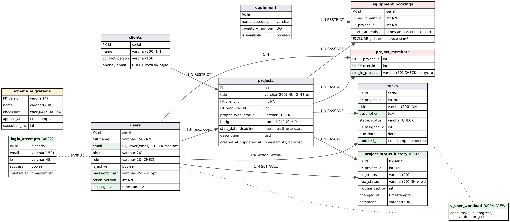

# Цель работы

Развить схему базы данных под требования версии 2.0 (ПР №9): определить новые сущности и атрибуты, спроектировать таблицы, связи, ограничения и индексы, учесть производительность, нормализацию и безопасность данных. Перевести изменение схемы на миграции, чтобы обновлять уже работающую БД без потери данных.

# 1. Анализ требований к данным

| Требование | Что нужно хранить | Решение в схеме |
|---|---|---|
| FR-11, FR-17 вход и учётные записи | хеш пароля, признак отзыва токенов, время входа | столбцы `users.password_hash`, `token_version`, `last_login_at` |
| NFR-05 защита от перебора | неудачные попытки входа по e-mail и IP | таблица `login_attempts` |
| FR-08, FR-13 этапы и история | кто, когда и из какого статуса перевёл проект | таблица `project_status_history` |
| FR-15 редактирование задач | описание задачи, время изменения | `tasks.description`, `tasks.updated_at` + триггер |
| FR-10 съёмочная группа | роль участника не может быть пустой | `CHECK` на `project_members.role_in_project` |
| FR-12 отчёт о загрузке | агрегаты по открытым задачам | представление `v_user_workload` + частичный индекс |
| FR-14 поиск | поиск по подстроке названия | триграммный индекс GIN |
| FR-09 бронирование | уже есть `equipment_bookings` с `EXCLUDE` | изменений не требуется |

Сущности и связи версии 1.0 (ПР №3–4) остаются: заказчики, проекты, сотрудники, задачи, группа, оборудование, брони.

# 2. Схема базы данных версии 2.0



**Новые таблицы**

| Таблица | Столбцы и типы | Ключи и ограничения |
|---|---|---|
| `login_attempts` | `id bigserial`, `email varchar(150)`, `ip varchar(45)`, `success boolean`, `created_at timestamptz` | PK; индексы `(lower(email), created_at DESC)` и `(ip, created_at DESC)` |
| `project_status_history` | `id bigserial`, `project_id int`, `old_status`, `new_status varchar(20)`, `changed_by int`, `changed_at timestamptz`, `comment varchar(500)` | FK на `projects` (CASCADE) и `users` (SET NULL); `CHECK old_status IS DISTINCT FROM new_status`; индекс `(project_id, changed_at DESC)` |
| `schema_migrations` | `version varchar(4)`, `name`, `checksum char(64)`, `applied_at`, `execution_ms` | PK `version`; журнал применённых миграций |

**Изменения существующих таблиц**

| Таблица | Изменение | Зачем |
|---|---|---|
| `users` | `+ password_hash varchar(255)`, `+ token_version int NOT NULL DEFAULT 0`, `+ last_login_at` | вход, отзыв токенов при выходе |
| `users` | уникальность e-mail без учёта регистра: `UNIQUE INDEX (lower(email))` вместо `UNIQUE (email)`, `CHECK` формата | `Orlova@…` и `orlova@…` — один сотрудник |
| `tasks` | `+ description text`, `+ updated_at timestamptz` и триггер `tasks_updated_at` | редактирование задач |
| `project_members` | `CHECK (length(trim(role_in_project)) > 0)` | роль из пробелов не допускается |

Типы выбраны по смыслу данных: деньги — `numeric(12,2)` (без ошибок округления), моменты времени — `timestamptz` (брони и журнал не зависят от часового пояса сервера), счётчики журналов — `bigserial` (записи входов растут быстрее остальных таблиц).

# 3. Механизм миграций

В версии 1.0 схема создавалась одним скриптом `01_schema.sql` при первом запуске контейнера БД. Такой скрипт нельзя повторно применить к работающей базе. В версии 2.0 каждое изменение — отдельный файл `db/migrations/NNNN_описание.sql`, а применяет их команда `python -m app.manage migrate` (модуль `app/manage.py`, без внешних библиотек).

| Миграция | Содержание |
|---|---|
| `0001_initial.sql` | схема версии 1.0 без изменений |
| `0002_auth.sql` | учётные записи, журнал входов, миграция данных: e-mail в нижний регистр |
| `0003_project_history.sql` | история статусов, миграция данных: начальная запись для каждого существующего проекта |
| `0004_tasks_and_reports.sql` | поля задач, индексы под отчёты и поиск, представление загрузки |

Правила работы механизма:

1. Журнал `schema_migrations` хранит номер, имя, SHA-256 содержимого и время выполнения каждой применённой миграции.
2. Каждая миграция выполняется в отдельной транзакции вместе с записью в журнал: она применяется целиком или не применяется совсем (PostgreSQL поддерживает транзакционный DDL).
3. `pg_advisory_lock` не даёт запустить две миграции одновременно (например, при двух экземплярах приложения).
4. Изменённый после применения файл отклоняется: исправления оформляются новой миграцией.
5. **Baseline:** если в базе уже есть таблицы версии 1.0, а журнала нет, миграция 0001 отмечается применённой, и выполняются только 0002–0004.
6. После миграций роли приложения `studio_app` выдаются права только на DML для новых таблиц, журнал миграций для неё только читается.

```text
$ python -m app.manage migrate --seed
applied 0001_initial (62 ms)
applied 0002_auth (7 ms)
applied 0003_project_history (4 ms)
applied 0004_tasks_and_reports (11 ms)
загружены тестовые данные db/seed.sql
$ python -m app.manage migrate
схема актуальна, новых миграций нет
```

Обновление стенда версии 1.0 (данные, созданные в 1.0, сохранились — ПР №13):

```text
baseline: схема версии 1.0 уже существует, 0001_initial отмечена применённой
applied 0002_auth (13 ms)
applied 0003_project_history (10 ms)
applied 0004_tasks_and_reports (22 ms)
```

Все миграции 0002–0004 **только добавляют** объекты (новые таблицы, столбцы с значениями по умолчанию, индексы). Поэтому код версии 1.0 продолжает работать на схеме 2.0 — это проверено откатом в ПР №13 и позволяет откатывать приложение без восстановления БД.

# 4. Оптимизация производительности

| Запрос | Индекс | Почему такой |
|---|---|---|
| Прогресс проекта: `count(*) FILTER (status='done') … WHERE project_id` | `(project_id, status)` | составной индекс заменил `(project_id)`: оба условия читаются из индекса |
| Отчёт о загрузке: открытые задачи по исполнителю | частичный `(assignee_id) WHERE status <> 'done'` | закрытые задачи копятся годами, а в отчёт не попадают — индекс остаётся маленьким |
| Список проектов по дедлайну | `(deadline NULLS LAST, id)` | совпадает с `ORDER BY` списка, позволяет постраничный вывод без сортировки |
| Поиск `title ILIKE '%клип%'` | GIN `gin_trgm_ops` (расширение `pg_trgm`) | обычный B-tree не работает с подстрокой в середине |
| Блокировка перебора: попытки за 15 минут | `(lower(email), created_at DESC)` | выборка последних попыток по e-mail |
| История проекта | `(project_id, changed_at DESC)` | вывод от новых к старым |

Проверка плана поиска: `Bitmap Index Scan on idx_projects_title_trgm`. Представление `v_user_workload` выполняется за 0,2 мс на тестовых данных.

**Кэширование и агрегирование.** Прогресс задач считается агрегатом при запросе, без хранения счётчиков: при сотнях проектов это быстрее, чем поддерживать счётчики триггерами, и данные не расходятся. Справочники (заказчики, оборудование) меняются редко — их можно кэшировать на стороне клиента; на этом этапе кэш не нужен, медиана ответа списка 43 мс (ПР №14).

# 5. Нормализация и денормализация

Схема находится в третьей нормальной форме: каждая таблица описывает одну сущность, неключевые атрибуты зависят только от ключа (имя заказчика хранится в `clients`, а не в проектах; роль сотрудника в проекте — в связующей таблице `project_members`).

Принятые сознательные отступления:

- `project_status_history.old_status` можно вычислить из предыдущей записи, но хранится явно: история читается без оконных функций и проверяется ограничением `old ≠ new`;
- `login_attempts.email` хранится строкой, а не ссылкой на `users`: попытки входа с несуществующим e-mail тоже нужно учитывать;
- отчёт о загрузке — представление, а не таблица: денормализованная таблица-агрегат понадобится только при большом объёме данных (тогда — `MATERIALIZED VIEW` с обновлением по расписанию).

# 6. Безопасность данных

| Мера | Реализация |
|---|---|
| Пароли | только хеш scrypt с солью (`scrypt:32768:8:1$…`), исходный пароль нигде не хранится |
| Разделение прав | миграции выполняет владелец схемы `studio_owner`; приложение работает ролью `studio_app` только с `SELECT/INSERT/UPDATE/DELETE` |
| Проверка прав роли | `CREATE TABLE` → `permission denied for schema public`; `DROP TABLE tasks` → `must be owner of table tasks`; изменение журнала миграций → `permission denied` |
| Целостность | внешние ключи, `CHECK` на статусы, этапы, даты, бюджет, e-mail, `EXCLUDE` на пересечение броней |
| Сеть | порт БД не публикуется, сеть `backend` в Docker помечена `internal` |
| Отзыв доступа | `token_version` увеличивается при выходе и смене пароля — все выданные токены перестают действовать |
| Шифрование | при передаче — TLS на прокси (ПР №13); резервные копии хранятся с правами 600 в каталоге 700 |

# 7. Проверка

Автотесты `tests/test_migrations.py` (5 тестов): применение по порядку и повторный запуск без изменений; обновление базы, созданной скриптом версии 1.0, с сохранением данных; отказ при изменённой миграции; откат миграции с ошибкой (частично созданная таблица не остаётся); работа новых ограничений. Все тесты остальных модулей создают БД теми же миграциями, что и сервер.

# Вывод

Схема БД развита под версию 2.0: добавлены 3 таблицы, 5 столбцов, 8 индексов, представление и новые ограничения. Изменения оформлены четырьмя миграциями с журналом, контрольными суммами, транзакциями и режимом baseline для базы версии 1.0. Схема остаётся в 3НФ с обоснованными отступлениями, индексы подобраны под реальные запросы, права роли приложения ограничены DML.
