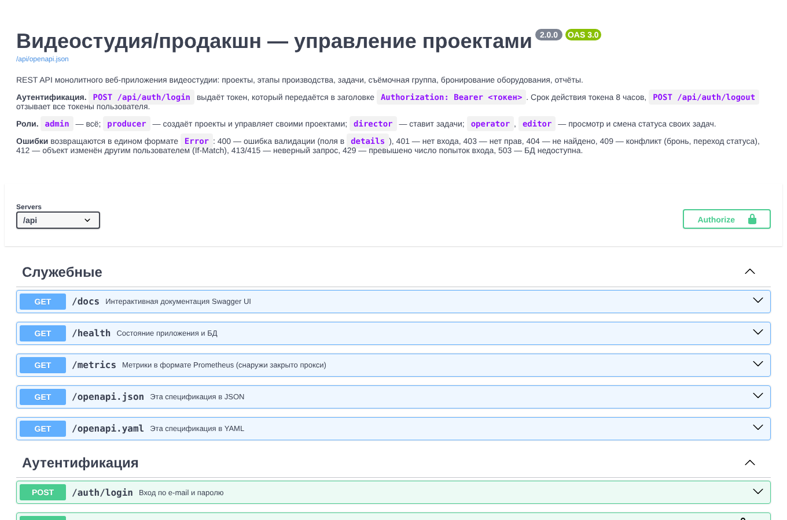

# Цель работы

Спроектировать RESTful API версии 2.0 для монолитного приложения: определить ресурсы и поддерживаемые HTTP-методы, маршруты и эндпоинты по принципам REST, форматы запросов и ответов, коды ошибок и правила доступа, и описать API машиночитаемой спецификацией OpenAPI 3.0 с интерактивной документацией.

# 1. Ресурсы API

Ресурсы выделены из сущностей предметной области (ПР №10) и сценариев (ПР №9). Вложенность в URL отражает принадлежность: задачи, группа, брони и история существуют только внутри проекта.

| Ресурс | Адрес коллекции / элемента | Сущность БД |
|---|---|---|
| Сеанс | `/auth/login`, `/auth/logout`, `/auth/me` | `users` (токен) |
| Проект | `/projects`, `/projects/{id}` | `projects` |
| История статусов | `/projects/{id}/history` | `project_status_history` |
| Участник группы | `/projects/{id}/members`, `/projects/{id}/members/{user_id}` | `project_members` |
| Задача | `/projects/{id}/tasks`, `/tasks/{id}` | `tasks` |
| Бронь | `/projects/{id}/bookings`, `/bookings/{id}`, `/equipment/{id}/bookings` | `equipment_bookings` |
| Справочники | `/clients`, `/users`, `/equipment` | `clients`, `users`, `equipment` |
| Отчёт | `/reports/workload` | представление `v_user_workload` |
| Служебные | `/health`, `/metrics`, `/openapi.json`, `/openapi.yaml`, `/docs` | — |

Задача и бронь создаются внутри проекта (`POST /projects/{id}/tasks`), а изменяются и удаляются по собственному адресу (`PATCH /tasks/{id}`): у них глобальный идентификатор, и клиенту не нужно знать проект, чтобы сменить статус задачи.

# 2. Методы и эндпоинты

Всего 31 операция. Базовый адрес — `/api`.

| Метод | Путь | Назначение | Права | Коды |
|---|---|---|---|---|
| POST | `/auth/login` | вход, выдача токена | все | 200, 400, 401, 429 |
| POST | `/auth/logout` | выход, отзыв токенов | вошедший | 204, 401 |
| GET | `/auth/me` | текущий пользователь | вошедший | 200, 401 |
| GET | `/projects?status=&q=&limit=&offset=` | список, фильтр, поиск, страницы | все роли | 200, 400 |
| POST | `/projects` | создать проект | admin, producer | 201, 400, 403, 415 |
| GET | `/projects/{id}` | карточка с задачами и группой | все роли | 200, 404 |
| PATCH | `/projects/{id}` | изменить поля, перевести по этапу | admin, продюсер проекта | 200, 400, 403, 404, 409, 412 |
| DELETE | `/projects/{id}` | удалить проект | admin | 204, 403, 404 |
| GET | `/projects/{id}/history` | история статусов | все роли | 200, 404 |
| GET | `/projects/{id}/members` | состав группы | все роли | 200, 404 |
| PUT | `/projects/{id}/members/{user_id}` | добавить или сменить роль | admin, продюсер проекта | 201, 200, 400, 403 |
| DELETE | `/projects/{id}/members/{user_id}` | исключить | admin, продюсер проекта | 204, 403, 404 |
| GET | `/projects/{id}/tasks` | задачи проекта | все роли | 200, 404 |
| POST | `/projects/{id}/tasks` | добавить задачу | admin, producer, director | 201, 400, 403, 409 |
| GET | `/tasks/{id}` | задача | все роли | 200, 404 |
| PATCH | `/tasks/{id}` | изменить задачу / статус | продюсер проекта; исполнитель — только статус | 200, 400, 403, 404 |
| DELETE | `/tasks/{id}` | удалить задачу | admin, продюсер проекта | 204, 403, 404 |
| GET | `/projects/{id}/bookings` | брони проекта | все роли | 200, 404 |
| POST | `/projects/{id}/bookings` | забронировать | admin, продюсер проекта | 201, 400, 403, 409 |
| DELETE | `/bookings/{id}` | отменить бронь | admin, продюсер проекта | 204, 403, 404 |
| GET | `/equipment/{id}/bookings?from=&to=` | занятость единицы | все роли | 200, 400, 404 |
| GET | `/clients`, `/users?role=`, `/equipment` | справочники | все роли | 200 |
| POST | `/users` | создать учётную запись | admin | 201, 400, 403 |
| GET | `/reports/workload` | загрузка сотрудников | admin, producer | 200, 403 |
| GET | `/health`, `/openapi.json`, `/openapi.yaml`, `/docs`, `/metrics` | служебные | без входа | 200, 503 |

# 3. Принципы REST, которые учтены

- **Существительные во множественном числе** в путях, действие задаёт метод: не `/createProject`, а `POST /projects`; перевод по этапу — изменение поля `status` через `PATCH`, а не отдельный глагол `/projects/1/advance`.
- **Семантика методов.** `GET` безопасен и ничего не меняет; `PUT /members/{user_id}` идемпотентен: повторный запрос не создаёт дубль, первый отвечает 201, следующие 200; `PATCH` меняет только переданные поля; `DELETE` отвечает 204 без тела, повторный — 404.
- **Коды состояния вместо флагов в теле:** 201 + заголовок `Location` после создания, 409 при конфликте с текущим состоянием (пересечение брони, недопустимый переход), 412 при устаревшей версии объекта.
- **Отсутствие состояния на сервере.** Каждый запрос несёт токен, сервер не хранит сеанс в памяти — экземпляров приложения может быть несколько.
- **Фильтрация и страницы в строке запроса** (`?status=shooting&q=клип&limit=20&offset=40`), общее число — в заголовке `X-Total-Count`. Тело ответа остаётся массивом, как в версии 1.0.
- **Оптимистическая блокировка.** `GET /projects/{id}` возвращает `ETag`; `PATCH` с заголовком `If-Match` выполнится, только если проект никто не изменил после чтения.
- **Обратная совместимость.** Адреса и форматы версии 1.0 сохранены, новые поля только добавлены. Поэтому номер версии в путь (`/api/v2`) не вводится; при несовместимом изменении будет добавлен префикс `/api/v3`, а старый будет работать параллельно.

# 4. Форматы данных

Запросы и ответы — JSON в UTF-8 (`Content-Type: application/json`), русский текст без экранирования. Другой тип тела отклоняется кодом 415, тело больше 64 КБ — 413. Даты — `ГГГГ-ММ-ДД`, моменты времени — ISO 8601 со смещением (`2026-11-20T09:00:00+03:00`); время без смещения из поля `datetime-local` считается временем студии (Europe/Moscow). Деньги — число.

Пример ответа `GET /api/projects/1` (сокращён):

```json
{
  "id": 1, "title": "Рекламный ролик «Утро с кофе»", "status": "shooting",
  "project_type": "commercial", "budget": 350000.0, "deadline": "2026-11-15",
  "client_name": "ООО «Северный кофе»", "producer_id": 2, "tasks_total": 4, "tasks_done": 2,
  "allowed_transitions": ["postproduction", "preproduction", "cancelled"],
  "can_manage": true,
  "members": [{"id": 3, "full_name": "Белова Мария Андреевна", "role": "director", "role_in_project": "Режиссёр"}],
  "tasks": [{"id": 3, "title": "Съёмочный день №1", "stage": "shooting", "status": "in_progress"}]
}
```

Поля `allowed_transitions` и `can_manage` вычисляются сервером: интерфейс показывает только доступные действия, не дублируя правила на клиенте.

**Единый формат ошибки** для всех кодов 4xx/5xx:

```json
{"error": "Ошибка валидации", "details": {"title": "Укажите название проекта", "deadline": "Дедлайн не может быть раньше даты начала"}}
```

| Код | Когда |
|---|---|
| 400 | ошибка в данных; `details` — сообщение по каждому полю, неизвестные поля тоже ошибка |
| 401 | нет токена, токен подделан, истёк или отозван; заголовок `WWW-Authenticate: Bearer` |
| 403 | токен верный, но роли не хватает прав |
| 404 | объект или адрес не найден |
| 409 | конфликт с состоянием: пересечение брони, недопустимый переход, задача в закрытом проекте |
| 412 | `If-Match` не совпал с текущей версией проекта |
| 413 / 415 | слишком большое тело / не JSON |
| 429 | превышено число попыток входа, заголовок `Retry-After` |
| 503 | БД недоступна |

# 5. Спецификация OpenAPI

Спецификация написана вручную в `app/openapi.yaml` (OpenAPI 3.0.3, около 750 строк) и отдаётся приложением:

- `/api/openapi.json` и `/api/openapi.yaml` — для генераторов клиентов и Postman;
- `/api/docs` — Swagger UI 5.17 (файлы хранятся в приложении, без внешних CDN, поэтому страница работает при строгой политике CSP). Если пользователь уже вошёл в веб-интерфейс, его токен подставляется в кнопку Authorize.

Структура спецификации: схема безопасности `bearerAuth` (HTTP Bearer) применяется ко всем операциям по умолчанию, у открытых операций `security: []`; общие ответы (`ValidationError`, `Unauthorized`, `Forbidden`, `NotFound`, `Conflict`) и схемы (`Project`, `Task`, `Booking`, `Error`, перечисления статусов и ролей) вынесены в `components` и переиспользуются через `$ref`.



Соответствие спецификации и кода проверяется автотестами `tests/test_openapi.py`:

1. спецификация проходит валидацию `openapi-spec-validator`;
2. множество пар «путь + метод» из спецификации **в точности совпадает** с маршрутами Flask (`app.url_map`): добавить маршрут без документации или описать несуществующий не получится — тест упадёт.

# 6. Инструменты

| Задача | Инструмент |
|---|---|
| Маршрутизация, JSON | Flask 3 (Blueprint `api`) |
| Описание API | OpenAPI 3.0.3 (YAML), PyYAML для отдачи в JSON |
| Документация | Swagger UI 5.17.14 |
| Проверка спецификации | openapi-spec-validator 0.7, тест сверки с `url_map` |
| Ручная проверка | curl, Swagger UI «Try it out» |
| Автотесты | pytest + тестовый клиент Flask |

# Вывод

Спроектирован REST API версии 2.0: 9 групп ресурсов, 31 операция, единый формат ошибок с 10 кодами, правила прав для каждой операции, постраничный вывод и оптимистическая блокировка. API описан спецификацией OpenAPI 3.0 с интерактивной документацией, а её полнота и корректность проверяются автотестами.
