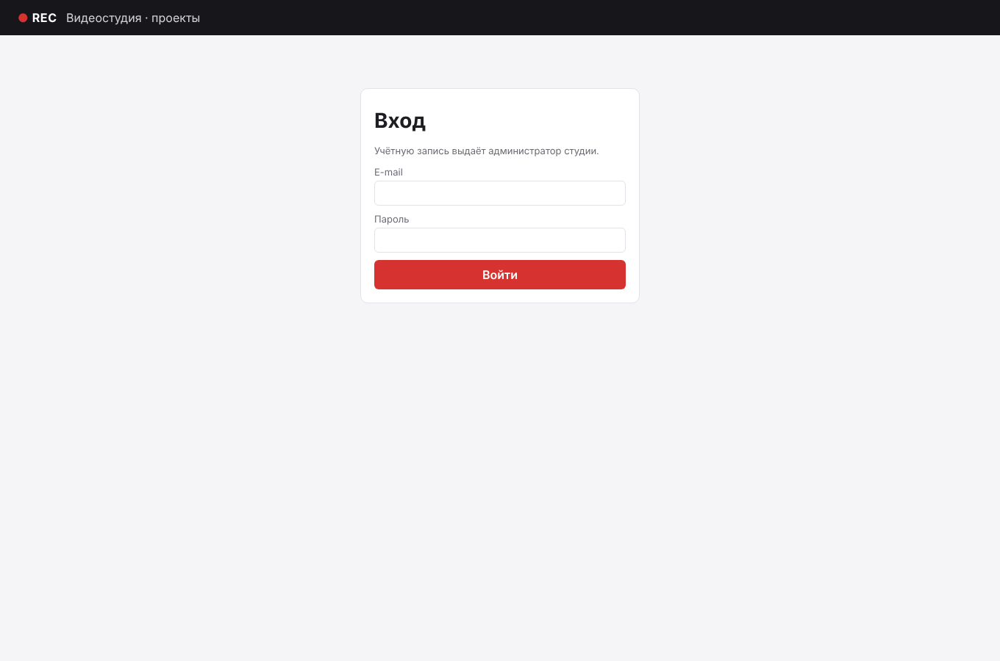
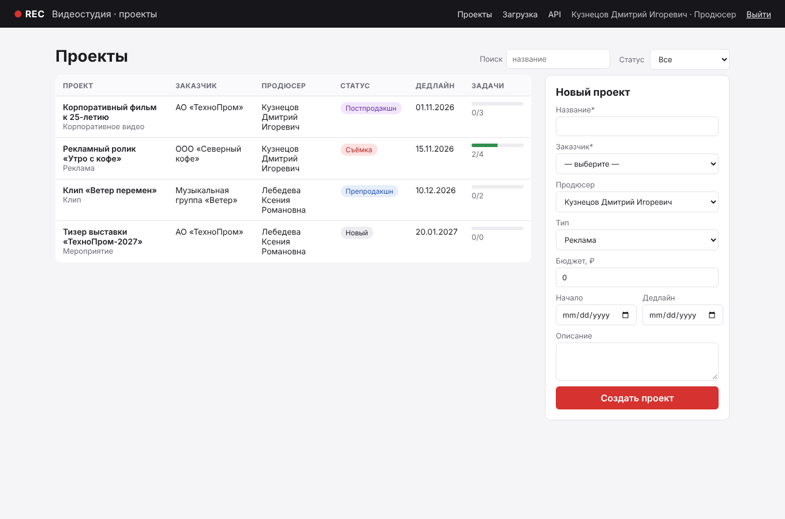
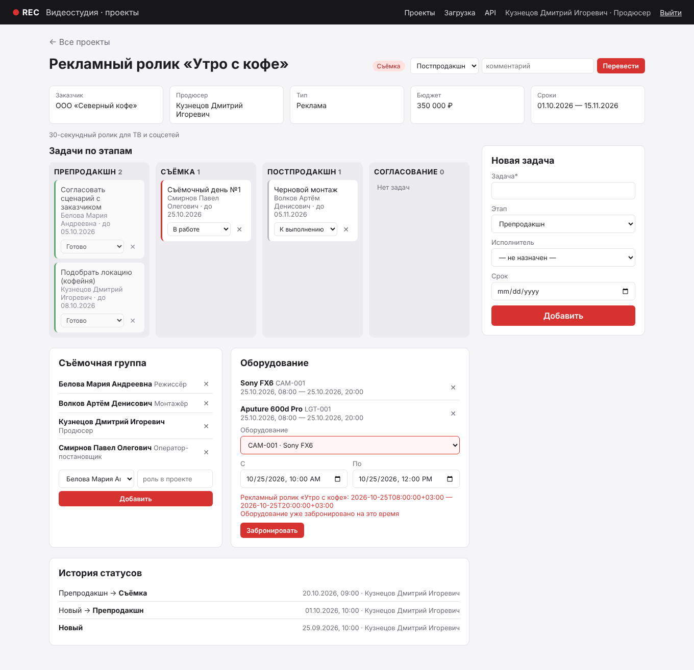
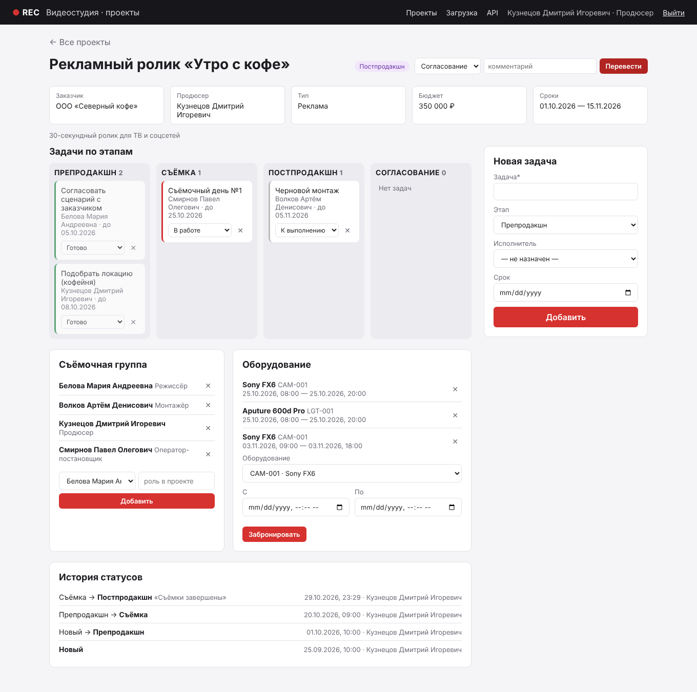
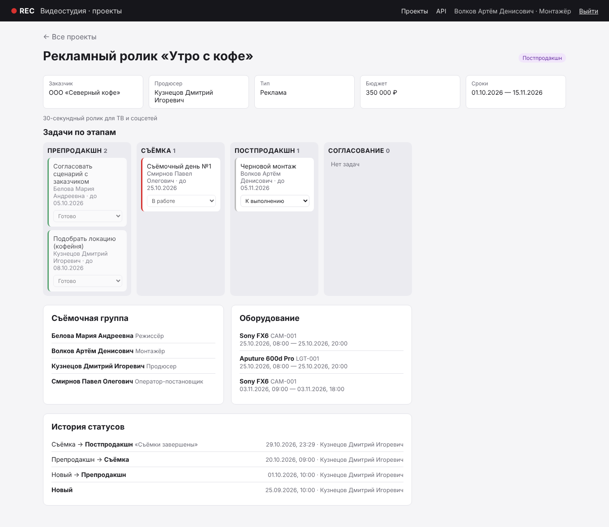
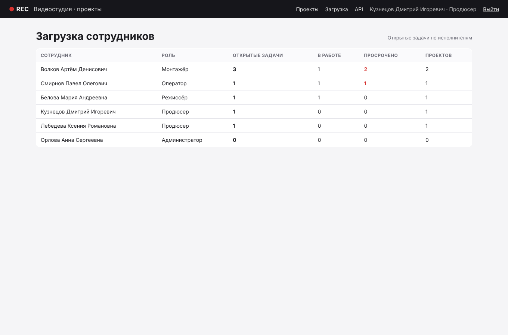

# Цель работы

Реализовать спроектированный в ПР №11 RESTful API: логику обработки запросов для каждого эндпоинта, форматы запросов и ответов, аутентификацию и авторизацию пользователей, защиту от типовых атак и утечек данных. Подключить новые ресурсы к веб-интерфейсу и проверить реализацию автотестами.

# 1. Устройство обработки запроса

Код разделён по ответственности, как и в версии 1.0:

| Модуль | Ответственность |
|---|---|
| `app/api.py` | маршруты: разбирают запрос, вызывают сервис, формируют код ответа и заголовки (`Location`, `ETag`, `X-Total-Count`) |
| `app/auth.py` | вход, выдача и проверка токена, декоратор ролей `@require_roles`, правило «продюсер своего проекта» |
| `app/services.py` | валидация данных и бизнес-правила: переходы статусов, пересечение броней, права на задачу |
| `app/db.py` | соединение на запрос, `transaction()` для нескольких изменений в одной транзакции |
| `app/errors.py` | единый JSON-формат ошибок, перевод исключений в коды 400/401/403/404/409/412/413/415/429/503 |
| `app/security.py` | заголовки безопасности для всех ответов |

Путь запроса `PATCH /api/projects/1 {"status": "postproduction"}`:

1. `before_request` проверяет токен и загружает пользователя (`g.user`), иначе 401;
2. `@require_roles("admin", "producer")` отсекает остальные роли (403);
3. `_json_body()` требует `Content-Type: application/json` (415) и JSON-объект (400);
4. `services.update_project` проверяет, что пользователь — продюсер этого проекта или администратор (403), `If-Match` (412), неизвестные поля и значения (400), правило перехода и закрытые задачи (409);
5. изменение проекта и запись истории выполняются в одной транзакции;
6. ответ 200 с обновлённой карточкой и новым `ETag`.

Пример реальных ответов развёрнутого стенда:

```text
PATCH /api/projects/1 {"status":"done"}
HTTP/2 409
{"details":{"status":"Из «shooting» можно перейти только в: postproduction, preproduction, cancelled"},
 "error":"Недопустимый переход статуса"}

POST /api/projects/3/bookings {"equipment_id":1,"starts_at":"2026-10-25T18:00","ends_at":"2026-10-25T22:00"}
HTTP/2 409
{"details":{"conflict":"Рекламный ролик «Утро с кофе»: 2026-10-25T08:00:00+03:00 — 2026-10-25T20:00:00+03:00",
 "equipment_id":"Оборудование уже забронировано на это время"},"error":"Оборудование уже занято в это время"}

GET /api/projects (без токена)
HTTP/2 401   www-authenticate: Bearer
{"error":"Требуется вход в систему"}
```

Пересечение броней проверяет ограничение `EXCLUDE` в БД, а приложение перехватывает `ExclusionViolation` и находит конфликтующую бронь для сообщения. Так правило соблюдается даже при двух одновременных запросах, когда проверка «сначала SELECT, потом INSERT» пропустила бы оба.

# 2. Аутентификация

**Вход.** `POST /api/auth/login {email, password}`. Пароль сравнивается с хешем scrypt (`werkzeug.security`). Если e-mail не существует, пароль всё равно проверяется по фиктивному хешу, и ответ одинаковый — `401 Неверный e-mail или пароль`: по ответу и по времени нельзя узнать, есть ли такой сотрудник.

**Токен.** Строка, подписанная `SECRET_KEY` (библиотека itsdangerous, HMAC-SHA1 с солью `studio-api-token`), содержит id сотрудника, `token_version` и время выдачи. Срок действия — 8 часов (`TOKEN_TTL`). При каждом запросе проверяются подпись, срок, активность сотрудника и совпадение `token_version` с БД.

**Выход и отзыв.** `POST /api/auth/logout` увеличивает `token_version` — все выданные сотруднику токены перестают приниматься (ответ «Сеанс завершён, войдите снова»). То же происходит при смене пароля командой `set-password` и при деактивации сотрудника.

**Защита от перебора.** Каждая попытка пишется в `login_attempts`. Пять неудачных попыток на e-mail или двадцать с одного IP за 15 минут — вход блокируется ответом `429` с `Retry-After: 900`, даже при верном пароле. Дополнительно nginx ограничивает `/api/auth/login` до 5 запросов в минуту с IP (ПР №13).

**Хранение токена в браузере** — `sessionStorage` вкладки: исчезает при закрытии браузера и не отправляется автоматически, как cookie, поэтому атаки CSRF к API неприменимы.

# 3. Авторизация по ролям

| Действие | admin | producer | director | operator / editor |
|---|---|---|---|---|
| Просмотр проектов, задач, групп, броней | ✓ | ✓ | ✓ | ✓ |
| Создать проект | ✓ | ✓ | — | — |
| Изменить проект, перевести по этапу, группа, брони | ✓ | только свои | — | — |
| Добавить задачу | ✓ | ✓ | ✓ | — |
| Изменить / удалить задачу | ✓ | своего проекта | если в группе | только статус своей задачи |
| Отчёт о загрузке | ✓ | ✓ | — | — |
| Удалить проект, создать учётную запись | ✓ | — | — | — |

Права проверяются на сервере. Интерфейс дополнительно скрывает недоступные кнопки (атрибут `data-roles` и поле `can_manage` карточки), но это только удобство.

# 4. Защита от атак и утечек данных

| Угроза | Мера |
|---|---|
| SQL-инъекция | все запросы параметризованы (`%s` в psycopg2); тест: поиск `'; DROP TABLE projects; --` возвращает пустой список, таблица на месте |
| XSS | в интерфейсе все данные выводятся через `escapeHtml`/`textContent`; политика `Content-Security-Policy: default-src 'self'; script-src 'self'; style-src 'self'` запрещает встроенные и чужие скрипты |
| Кликджекинг | `X-Frame-Options: DENY`, `frame-ancestors 'none'` |
| Подмена типа | `X-Content-Type-Options: nosniff`, API принимает только `application/json` (415) |
| Перебор паролей | блокировка после 5 ошибок, ограничение частоты в nginx |
| Перечисление учётных записей | одинаковый ответ и время для неверного пароля и несуществующего e-mail |
| Массовое присвоение полей | `PATCH` отклоняет поля вне списка разрешённых (`id`, `created_at` → 400) |
| Потерянное обновление | `ETag` / `If-Match` → 412 |
| Отказ в обслуживании большим телом | `MAX_CONTENT_LENGTH` 64 КБ (413), лимит в nginx |
| Утечка персональных данных | ответы API с `Cache-Control: no-store`; хеш пароля никогда не попадает в ответы; `Referrer-Policy: no-referrer`; тексты ошибок 500 без трассировки |
| Утечка секретов | пароли и `SECRET_KEY` только в `.env` (не в git); при `APP_ENV=production` приложение не запустится с ключом по умолчанию |
| Перехват трафика | HTTPS на прокси, HSTS (ПР №13) |
| Открытое перенаправление | страница входа переходит только на локальные адреса из `next` |

# 5. Веб-интерфейс версии 2.0

Страницы получают данные из того же API с токеном. Новые возможности: страница входа, имя и роль в шапке, поиск и постраничный вывод проектов, перевод проекта по этапам с комментарием, история статусов, управление группой и бронями, удаление задач, отчёт о загрузке, ссылка на документацию API.













# 6. Тестирование

65 автотестов (pytest, реальная PostgreSQL, перед каждым тестом схема создаётся миграциями):

| Модуль | Тестов | Что проверяет |
|---|---|---|
| `test_api.py` | 14 | сценарий версии 1.0 без изменений — обратная совместимость |
| `test_api_v2.py` | 15 | этапы и история, недопустимые переходы, сдача с открытыми задачами, ETag, группа (идемпотентность PUT), брони и пересечения, стык интервалов, задачи, отчёт |
| `test_auth.py` | 23 | вход, одинаковые ошибки, блокировка перебора, подделанный и истёкший токен, выход, деактивация, матрица ролей, хеш пароля, заголовки, 413/415, SQL-инъекция |
| `test_migrations.py` | 5 | миграции (ПР №10) |
| `test_openapi.py` | 3 | спецификация (ПР №11) |
| `test_observability.py` | 5 | журнал и метрики (ПР №14) |

```text
$ pytest -q
.................................................................        [100%]
65 passed in 18.38s
```

# Вывод

API версии 2.0 реализован полностью по спецификации: 31 операция, проверка данных и бизнес-правил на сервере, транзакции для связанных изменений и защита правил ограничениями БД. Добавлены вход по паролю с токенами, отзывом и защитой от перебора, ролевая модель с правилом «продюсер своего проекта», меры против инъекций, XSS, кликджекинга и утечек данных. Интерфейс использует новые ресурсы, все 65 тестов проходят, включая неизменённые тесты версии 1.0.
