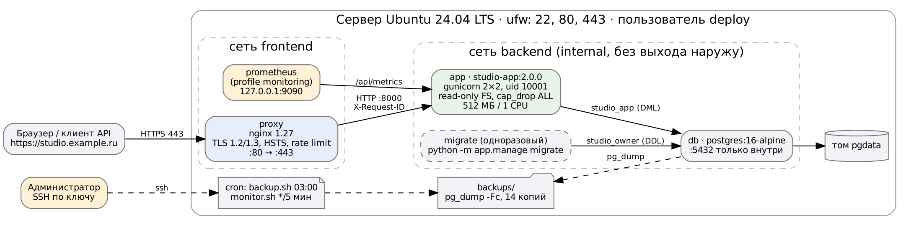
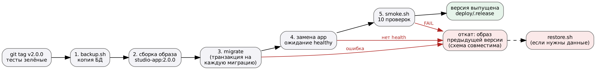

# Цель работы

Выпустить версию 2.0.0 ИС «Видеостудия»: выбрать серверную инфраструктуру, подготовить сервер (ОС, зависимости, пользователь и права), развернуть приложение и настроить окружение для его запуска и обновления, применить меры безопасности (брандмауэр, обновления, HTTPS) и настроить проверку работоспособности. Обновить работающий стенд версии 1.0 до 2.0 без потери данных.

# 1. Выбор серверной инфраструктуры

| Вариант | Плюсы | Минусы | Решение |
|---|---|---|---|
| PaaS (Render, Heroku-подобные) | не нужно администрировать ОС | ограничения на PostgreSQL-расширения (`btree_gist`), платные БД, мало контроля над сетью | нет |
| Kubernetes в облаке | масштабирование, самовосстановление | избыточно для одного монолита и одного администратора | нет |
| ВМ без контейнеров | минимум слоёв | ручная установка Python/PostgreSQL, трудно повторить и откатить | нет |
| **VPS + Docker Compose** | одинаковое окружение на стенде и сервере, откат сменой образа, дёшево | ОС обслуживаем сами | **да** |

Целевой сервер: VPS **Ubuntu 24.04 LTS**, 2 vCPU, 2 ГБ RAM, 20 ГБ SSD. Учебный стенд, на котором выполнен выпуск, — Linux-машина с Docker Engine 29 и той же конфигурацией compose (порты на 127.0.0.1:8080/8443 вместо 80/443, самоподписанный сертификат вместо Let's Encrypt).

Факторы выбора: требования к ПО (PostgreSQL 16 с расширениями), объём нагрузки (десятки пользователей студии), бюджет, возможность отката, наличие у команды навыков Docker из ПР №7–8.



# 2. Настройка сервера

Полная инструкция — `deploy/SERVER.md`. Основные шаги:

| Шаг | Команды / настройка | Зачем |
|---|---|---|
| Обновление ОС | `apt full-upgrade`, пакет `unattended-upgrades` | закрыть известные уязвимости, ставить исправления безопасности автоматически |
| Пользователь | `adduser deploy`, ключ в `~/.ssh/authorized_keys`, группа `docker` | выпуск версий не от root |
| SSH | `PasswordAuthentication no`, `PermitRootLogin no`, `fail2ban` | вход только по ключу, блокировка перебора |
| Брандмауэр | `ufw default deny incoming`, `allow OpenSSH, 80/tcp, 443/tcp` | открыты только нужные порты |
| Docker | `get.docker.com`, `daemon.json`: ротация журналов, `live-restore` | журналы не переполнят диск, контейнеры переживают перезапуск демона |
| Время | `timedatectl set-timezone Europe/Moscow` | корректные журналы и брони |
| Конфигурация | `/opt/studio/.env`, `chmod 600` | секреты доступны только владельцу |
| Сертификат | `certbot certonly --standalone -d <домен>` | доверенный HTTPS |

Docker публикует порты в обход ufw, поэтому в compose наружу открыт **только прокси**; порты приложения (8000) и БД (5432) не публикуются вообще, а сеть БД помечена `internal` и не имеет выхода в интернет.

# 3. Окружение приложения (docker-compose.yml)

| Сервис | Образ | Назначение и настройки |
|---|---|---|
| `db` | postgres:16-alpine | данные в томе `pgdata`, только сеть `backend`, healthcheck `pg_isready` |
| `migrate` | studio-app:2.0.0 | одноразовый запуск `python -m app.manage migrate` ролью-владельцем; приложение стартует только после его успешного завершения (`service_completed_successfully`) |
| `app` | studio-app:2.0.0 | gunicorn 2 процесса × 2 потока, пользователь uid 10001, файловая система только для чтения, `cap_drop: ALL`, `no-new-privileges`, лимит 1 CPU / 512 МБ, healthcheck `/api/health` |
| `proxy` | nginx:1.27-alpine | TLS, перенаправление 80 → 443, ограничение частоты, healthcheck по HTTPS |
| `prometheus` | prom/prometheus:v2.54.1 | профиль `monitoring`, только 127.0.0.1:9090 (ПР №14) |

Образ приложения собирается с меткой версии (`APP_VERSION`), образы предыдущих версий остаются на сервере для отката.

**Настройки nginx** (`deploy/nginx/studio.conf`): TLS 1.2/1.3, `Strict-Transport-Security: max-age=31536000`, `server_tokens off`, `client_max_body_size 64k`, сжатие JSON; `limit_req` — 5 запросов в минуту на вход и 20 запросов в секунду на API с одного IP (ответ 429); адрес `/api/metrics` снаружи отвечает 404; каждый запрос получает `X-Request-ID`, который приложение пишет в журнал. Адрес приложения перечитывается через DNS Docker (`resolver 127.0.0.11`, `server app:8000 resolve`) — после пересоздания контейнера при выпуске nginx не обращается к старому IP.

**Производительность окружения:** постоянные соединения nginx → gunicorn (`keepalive 16`), плановый перезапуск рабочих процессов каждые ~2000 запросов против утечек памяти, `graceful_timeout` для завершения текущих запросов при перезапуске.

# 4. Процедура выпуска



Выпуск выполняет скрипт `deploy/release.sh <версия>`:

1. `git checkout v<версия>` (тег в репозитории);
2. резервная копия БД (`deploy/backup.sh`);
3. сборка образа `studio-app:<версия>`;
4. миграции схемы — каждая в своей транзакции; при ошибке схема остаётся прежней;
5. замена контейнера `app` и ожидание статуса `healthy`;
6. smoke-тест `deploy/smoke.sh`: 10 проверок по HTTPS, включая вход и закрытость метрик;
7. запись версии в `deploy/.release`; при ошибке на шагах 4–6 — автоматический откат на образ предыдущей версии.

# 5. Обновление стенда 1.0 → 2.0: что произошло

Перед выпуском на стенде работала версия 1.0 (ПР №7–8), в ней был создан проект «Музыкальный клип «Север» (создан в v1)» с задачей.

Выпуск запускался из рабочей копии репозитория (`SKIP_GIT=1 ./deploy/release.sh 2.0.0`), тег `v2.0.0` поставлен после публикации кода в GitHub; на сервере тот же скрипт сам переключается на тег.

**Первая попытка выпуска завершилась откатом:**

```text
[release 20:35:13] резервная копия перед выпуском
backup ok: backups/studio_20261029_203513.dump (32K, 0 с), хранится копий: 1
[release 20:35:14] миграции схемы
baseline: схема версии 1.0 уже существует, 0001_initial отмечена применённой
applied 0002_auth (13 ms)
applied 0003_project_history (10 ms)
applied 0004_tasks_and_reports (22 ms)
[release 20:35:35] smoke-тест
FAIL health: ожидали 200, получили 000
FAIL вход orlova@studio.local
[release 20:35:36] ОШИБКА: smoke-тест не пройден
[release 20:35:36] откат приложения на версию 1.0.0
```

| Проблема | Причина | Исправление |
|---|---|---|
| health = 000 | smoke-тест начался, пока nginx только запускался | release.sh ждёт ответа прокси до 30 с перед проверкой |
| вход не прошёл | у сотрудников из версии 1.0 нет паролей — их не было в схеме 1.0 | шаг обновления: `docker compose run --rm -T migrate python -m app.manage set-password <email>`; учётная запись для smoke-теста задаётся в `.env` (`SMOKE_EMAIL`, `SMOKE_PASSWORD`); записано в CHANGELOG |

Откат сработал как задумано: версия 1.0 продолжила работать **на уже обновлённой схеме 0004** (`{"db":"ok","status":"ok"}`, список проектов открывается) — подтверждена совместимость миграций.

**Вторая попытка — успешно:**

```text
[release 20:36:02] резервная копия перед выпуском
[release 20:36:03] миграции схемы
схема актуальна, новых миграций нет
[release 20:36:04] замена приложения
[release 20:36:14] smoke-тест
OK   health (200)          OK   версия (200)         OK   главная страница (200)
OK   API без входа (401)   OK   метрики снаружи закрыты (404)
OK   вход orlova@studio.local
OK   список проектов (200) OK   несуществующий проект (404)
OK   создание с ошибкой валидации (400)              OK   отчёт о загрузке (200)
{"db":"ok","db_ms":7.6,"schema":"0004","status":"ok","uptime_s":8,"version":"2.0.0"}
[release 20:36:15] версия 2.0.0 выпущена (предыдущая: 1.0.0)
```

Проверка после выпуска: проект, созданный в версии 1.0, на месте, для него автоматически появилась запись истории «Перенесено при обновлении до версии 2.0»; журнал `schema_migrations` содержит 4 записи.

```text
SERVICE      IMAGE                     STATUS                   PORTS
app          studio-app:2.0.0          Up (healthy)             8000/tcp
db           postgres:16-alpine        Up (healthy)             5432/tcp
proxy        nginx:1.27-alpine         Up (healthy)             127.0.0.1:8080->80, 127.0.0.1:8443->443
prometheus   prom/prometheus:v2.54.1   Up                       127.0.0.1:9090->9090
```

# 6. Проверка мер безопасности

| Проверка | Результат |
|---|---|
| `curl -I http://127.0.0.1:8080/` | `301 Moved Permanently` на HTTPS, заголовок `Server: nginx` без версии |
| `openssl s_client -connect 127.0.0.1:8443` | `TLSv1.3, TLS_AES_256_GCM_SHA384` |
| Заголовки ответа HTTPS | `strict-transport-security`, `content-security-policy`, `x-frame-options: DENY`, `x-request-id` |
| 400 запросов в 8 потоков на `/api/projects` через прокси | 60 ответов 200, 340 ответов 429 — ограничение частоты работает |
| `/api/metrics` снаружи | 404 |
| Роль `studio_app`: `CREATE TABLE`, `DROP TABLE tasks` | `permission denied`, `must be owner` |
| Порты БД и приложения на хосте | не опубликованы |

# 7. Мониторинг после выпуска

Работоспособность контролируется на трёх уровнях: healthcheck контейнеров Docker (`app`, `proxy`, `db` — статус `healthy`), внешний скрипт `deploy/monitor.sh` по cron каждые 5 минут (health по HTTPS, состояние контейнеров, диск, возраст резервной копии, оповещение в журнал и вебхук) и Prometheus с правилами оповещений. Подробно и с проверкой сбоев — в ПР №14.

# 8. Надёжность и отказоустойчивость

- `restart: unless-stopped` для всех сервисов и `live-restore` демона Docker;
- приложение запускается только после успешных миграций, прокси — только после `healthy` приложения;
- миграции транзакционны и совместимы назад — откат приложения не требует отката БД;
- резервная копия перед каждым выпуском и ежедневно;
- лимиты CPU и памяти не дают одному контейнеру занять весь сервер;
- следующий шаг для высокой доступности: два экземпляра `app` за nginx (приложение без состояния) и потоковая реплика PostgreSQL.

# Вывод

Версия 2.0.0 выпущена на стенде по воспроизводимой процедуре: резервная копия, сборка образа, миграции, замена приложения, smoke-тест и автоматический откат. Первая попытка выявила две реальные проблемы выпуска и подтвердила, что откат работает, вторая прошла все 10 проверок. Данные версии 1.0 сохранены. Сервер защищён брандмауэром, входом по ключу, автоматическими обновлениями, HTTPS с HSTS, ограничением частоты и минимальными правами контейнеров и роли БД.
