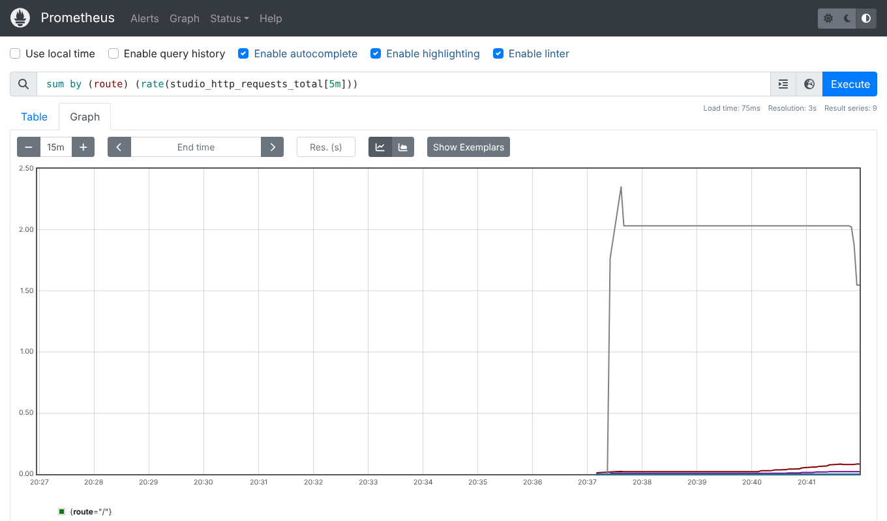
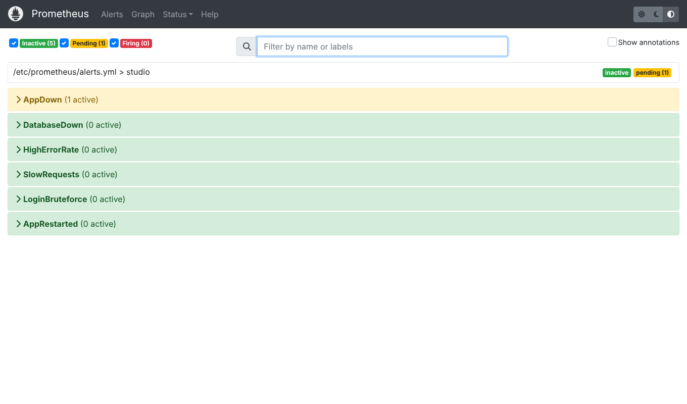

# Цель работы

Настроить наблюдение за серверным окружением и приложением версии 2.0 (журналы, метрики, проверки работоспособности, оповещения), организовать резервное копирование и восстановление, проверить отказоустойчивость на реальных сбоях и измерить время восстановления. Работа продолжает ПР №13: окружение то же, задача — обеспечить стабильную и безопасную эксплуатацию.

# 1. Что и как наблюдаем

| Уровень | Средство | Что показывает |
|---|---|---|
| Контейнеры | healthcheck Docker для `db`, `app`, `proxy` | `healthy` / `unhealthy`, автоматический перезапуск упавших процессов |
| Приложение | `GET /api/health` | версия, версия схемы, доступность и время ответа БД, время работы; 503 при отказе БД |
| Запросы | журнал JSON (`LOG_FORMAT=json`) | одна строка на запрос: метод, путь, код, время, IP, пользователь, `request_id` |
| Метрики | `GET /api/metrics` (Prometheus) | число и время запросов по маршрутам, входы, проекты по статусам, просроченные задачи, доступность БД |
| Оповещения | Prometheus `alerts.yml` | 6 правил: AppDown, DatabaseDown, HighErrorRate, SlowRequests, LoginBruteforce, AppRestarted |
| Внешняя проверка | `deploy/monitor.sh` (cron, 5 мин) | health по HTTPS, контейнеры, диск > 85 %, возраст копии > 26 ч; оповещение в системный журнал и вебхук |

**Журнал.** Каждый запрос получает `X-Request-ID` (от nginx или сгенерированный), он возвращается клиенту и пишется в каждую строку журнала — по номеру из жалобы пользователя находится конкретный запрос. Запросы дольше 500 мс (NFR-01) пишутся с уровнем WARNING. Частые опросы health и metrics в журнал не пишутся, если они успешны. Журналы контейнеров ротируются (5 файлов по 10 МБ).

```json
{"ts": "2026-10-29T23:40:31.274", "level": "ERROR", "logger": "studio.health",
 "msg": "health: database unavailable: could not translate host name \"db\" to address",
 "request_id": "f14681daedb82abcc67cb5e4c7b11d19"}
```

**Метрики.** Библиотека `prometheus-client` в многопроцессном режиме: счётчики всех процессов gunicorn собираются через каталог `PROMETHEUS_MULTIPROC_DIR` (tmpfs), поэтому Prometheus видит сумму, а не данные одного случайного процесса. Бизнес-показатели (проекты по статусам, просроченные задачи) считаются запросом к БД в момент опроса. Снаружи адрес метрик закрыт nginx, при необходимости дополнительно защищается токеном `METRICS_TOKEN`.





# 2. Резервное копирование

`deploy/backup.sh` (cron, ежедневно в 03:00, а также перед каждым выпуском):

1. `pg_dump -Fc` — сжатая копия в формате custom (позволяет восстанавливать выборочно);
2. проверка читаемости копии `pg_restore --list` до того, как она считается готовой;
3. контрольная сумма SHA-256 рядом с файлом, права 600, каталог 700;
4. ротация: хранятся 14 последних копий;
5. отметка `backups/last_success`, которую проверяет `monitor.sh`.

Копии ежедневно переносятся за пределы сервера (инструкция в `deploy/SERVER.md`): копия на том же диске не защищает от его потери.

**Целевые показатели:** RPO (допустимая потеря данных) ≤ 24 ч — одна ежедневная копия; RTO (время восстановления) ≤ 15 мин.

# 3. Проверка сбоев на стенде

## 3.1. Аварийное завершение приложения

Главный процесс gunicorn убит сигналом SIGKILL (как при падении от нехватки памяти):

```text
2026-10-29T20:44:11 OK {"db":"ok","db_ms":9.5,"schema":"0004","status":"ok","version":"2.0.0"}
--- SIGKILL главного процесса приложения
2026-10-29T20:44:13 ALERT контейнер app: running/starting
health снова 200 через 1.9 с
RestartCount=1 Status=running
```

Docker перезапустил контейнер по политике `restart: unless-stopped`, monitor.sh зафиксировал сбой, через 1,9 с сервис снова отвечает (требование NFR-08 — не более 30 с).

## 3.2. Отказ базы данных

Контейнер БД остановлен на 50 секунд:

```text
GET /api/health   → 503 {"db":"unavailable","status":"fail","version":"2.0.0"}
GET /api/projects → 503 {"error":"База данных недоступна"}
Prometheus alert: DatabaseDown firing - Приложение работает, но БД недоступна
БД запущена, health 200 через 51 с после отказа (без перезапуска приложения)
```

Приложение не упало: оно отвечает понятной ошибкой 503 (балансировщик и мониторинг видят, что экземпляр неисправен), Prometheus перевёл оповещение DatabaseDown в состояние firing через 30 с, а после запуска БД работа продолжилась сама — соединение создаётся на каждый запрос заново. Во время отказа также сработало правило HighErrorRate (pending) — доля ответов 5xx превысила 5 %.

## 3.3. Ошибочное удаление данных и восстановление

Сценарий: сделана резервная копия, затем создан ещё один проект, затем «по ошибке» удалены два проекта (вместе с задачами и бронями по каскаду). Восстановление — `deploy/restore.sh <копия> --yes`:

```text
backup ok: backups/studio_20261029_204135.dump (44K, 0 с)
создан проект после копии: HTTP 201
DELETE 2                                      ← ошибка оператора
проектов после ошибки: 4
backups/studio_20261029_204135.dump: OK       ← контрольная сумма
1/5 остановка приложения
2/5 пересоздание БД
3/5 загрузка копии
4/5 миграции (если копия старше текущей версии схемы)
схема актуальна, новых миграций нет
5/5 запуск и проверка
smoke-тест пройден
restore ok за 12 с
проектов после восстановления: 5, проект 1: Рекламный ролик «Утро с кофе», проект после копии: 0
```

Удалённые проекты вернулись. Проект, созданный после копии, потерян — это и есть RPO: теряются изменения с момента последней копии. Фактическое RTO — 12 секунд на учебном объёме (44 КБ); на рабочем объёме время определяется в основном размером копии.

Шаг 4 делает восстановление безопасным и для старых копий: если копия снята до выпуска новой версии, недостающие миграции применяются автоматически.

## 3.4. Неудачный выпуск

Проверен в ПР №13: smoke-тест не прошёл, `release.sh` автоматически вернул образ версии 1.0, которая продолжила работать на новой схеме.

## 3.5. Нагрузка

1000 запросов `GET /api/projects` с токеном в 8 потоков напрямую к приложению (внутри сети compose):

```text
запросов 1000, потоков 8, 5.6 с, 177 rps, коды {200: 1000}
медиана 43 мс, p95 73 мс, max 244 мс
```

Требование NFR-01 (≤ 500 мс) выполняется с запасом. Через прокси тот же поток ограничивается до 20 запросов в секунду с одного IP (ответы 429) — это защита от перегрузки, а не ошибка.

# 4. Сводка

| Сбой | Как обнаружен | Восстановление | Время | Потеря данных |
|---|---|---|---|---|
| Падение процесса приложения | healthcheck, monitor.sh, AppRestarted | автоматически, restart policy | 1,9 с | нет |
| Отказ БД | 503 в health, DatabaseDown, HighErrorRate | автоматически после запуска БД | сразу после БД | нет |
| Удаление данных | пользователь / журнал | restore.sh из копии | 12 с | с момента копии (RPO ≤ 24 ч) |
| Неудачный выпуск | smoke-тест release.sh | автоматический откат образа | ~2 с | нет |
| Перегрузка с одного адреса | метрики 429 в nginx | ограничение частоты | — | нет |
| Подбор пароля | LoginBruteforce, журнал входов | блокировка на 15 мин | — | нет |

# 5. Меры для высокой надёжности

- **Предотвращение:** лимиты ресурсов контейнеров, ротация журналов, контроль диска, плановый перезапуск рабочих процессов, автоматические обновления безопасности ОС.
- **Обнаружение:** healthcheck на трёх сервисах, метрики и 6 правил оповещений, внешняя проверка по HTTPS раз в 5 минут, `X-Request-ID` для расследования.
- **Восстановление:** автоматический перезапуск, транзакционные и совместимые назад миграции, откат образа, ежедневные проверенные копии с контрольными суммами, скрипт восстановления со smoke-тестом.
- **Регламент:** раз в месяц — учебное восстановление из копии на отдельном стенде, раз в квартал — проверка, что копии за пределами сервера читаются.
- **Развитие:** Alertmanager для оповещений в мессенджер, Grafana для панелей, архивирование WAL (point-in-time recovery) для RPO в минуты, реплика PostgreSQL и второй экземпляр приложения.

# 6. Автотесты наблюдаемости

`tests/test_observability.py` (5 тестов): генерация и передача `X-Request-ID` (мусорный заголовок отбрасывается), наличие метрик запросов и бизнес-показателей, защита метрик токеном, ответ 503 health при недоступной БД при работающих метриках, формат строки журнала JSON.

# Вывод

Для версии 2.0 настроено наблюдение на уровне контейнеров, приложения и запросов: JSON-журнал с идентификатором запроса, метрики Prometheus со всех процессов, 6 правил оповещений и внешняя проверка по расписанию. Организовано проверяемое резервное копирование с ротацией. На стенде воспроизведены пять видов сбоев: приложение поднимается за 1,9 с, отказ БД обрабатывается без падения и проходит сам, данные восстанавливаются из копии за 12 с, неудачный выпуск откатывается автоматически. Требования NFR-08, NFR-10 и NFR-11 выполнены.
